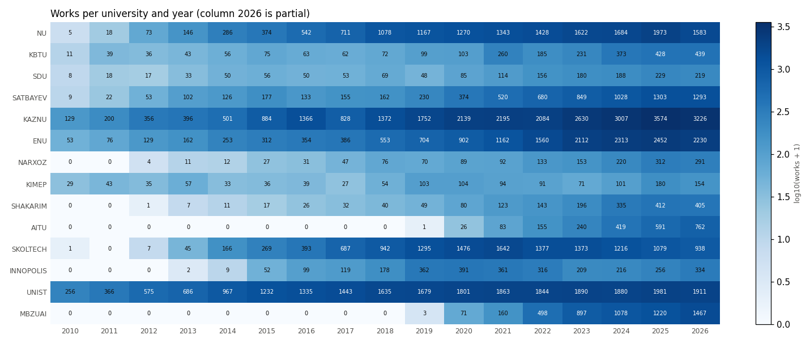
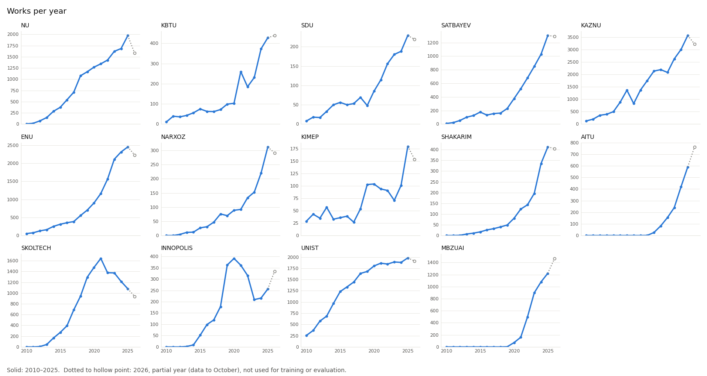
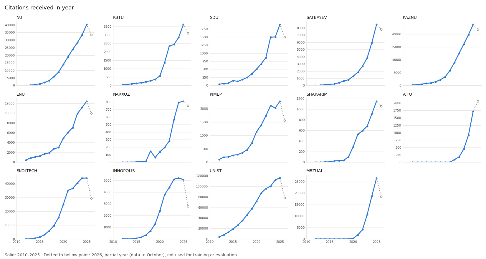
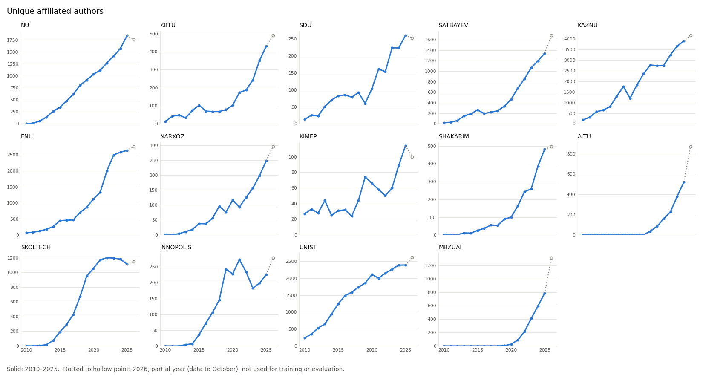
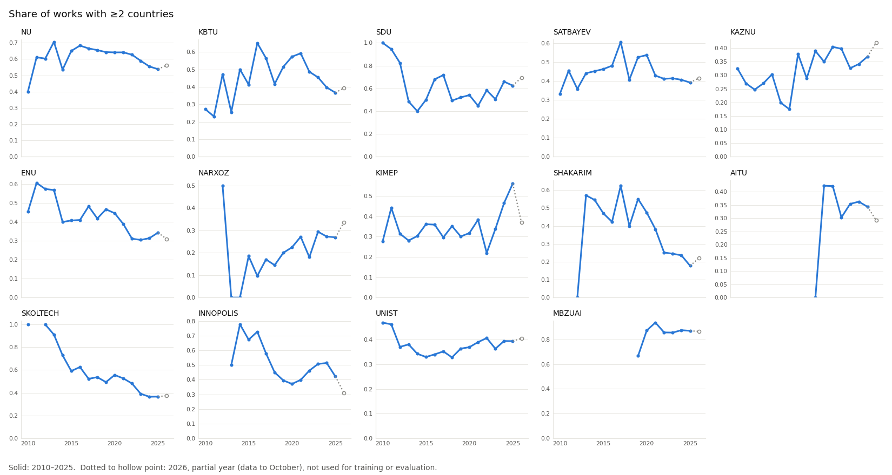
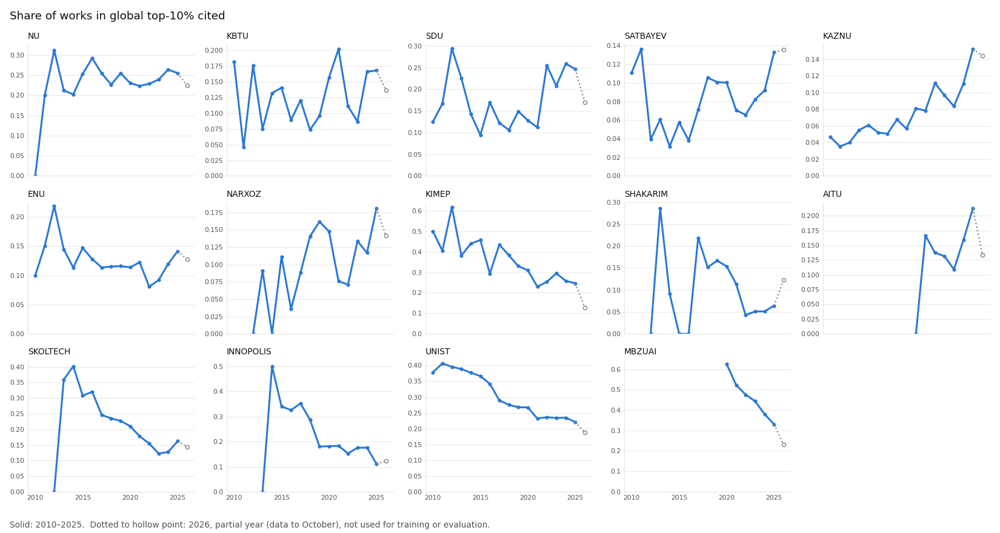
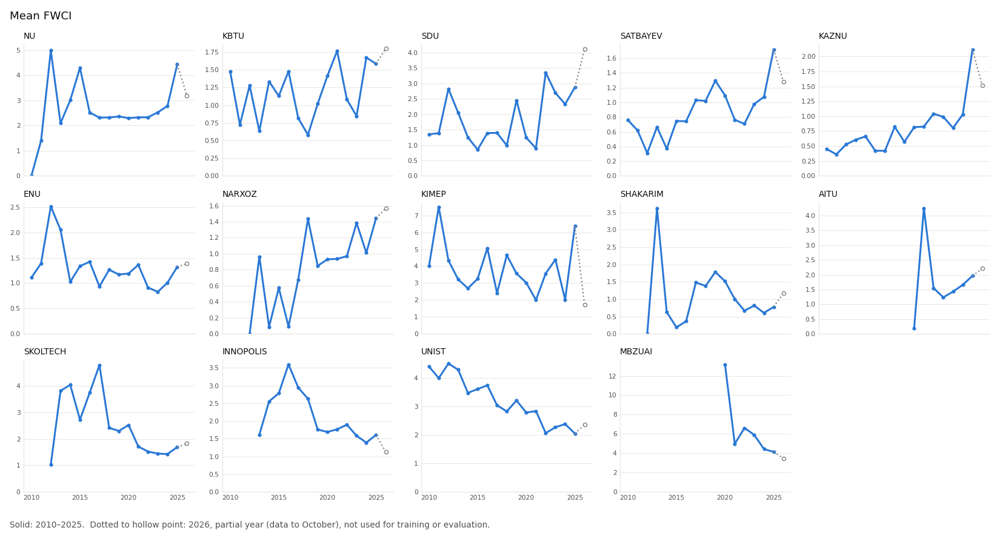
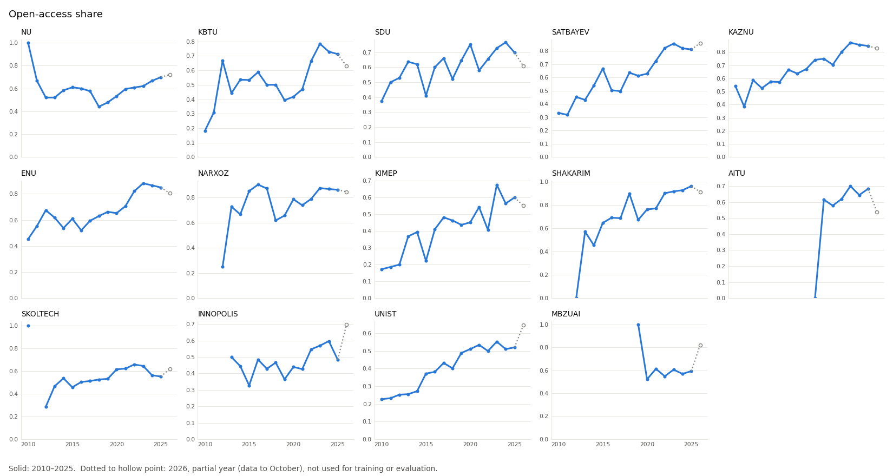
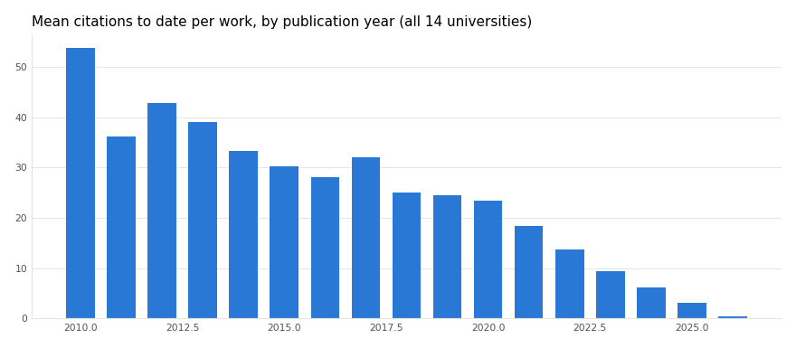

# DATA_AUDIT.md — панель «вуз × год» из OpenAlex

Дата выгрузки: 2026-10-09. Источник: OpenAlex API (режим вежливого API с `mailto`), ROR API.
Код: `src/research/` (`panel.py`, `audit.py`, `baseline.py`). Данные лежат в `data/research/` и не попадают в git.

## 0. Коротко

- Собрана панель **14 вузов × 17 лет (2010–2026) = 238 строк, 40 колонок**. 2026 год помечен `is_partial=True` и не используется ни в обучении, ни в оценке. Для моделей остаётся 14 × 16 = 224 строки, из них 26 строк с нулём работ (вуз ещё не публиковался).
- Все 14 вузов нашлись в OpenAlex однозначно, у каждого свой ROR. Исключённых нет, но два вуза помечены особо:
  - **SDU**: в OpenAlex подозревается смешение с турецким Süleyman Demirel Üniversitesi (§7).
  - **AITU и MBZUAI**: короткие ряды, полных лет с ≥10 работами только 6 (2020–2025).
- Найдены две ловушки API:
  1. Поле `counts_by_year.cited_by_count` у института считает цитаты **к работам, опубликованным в году Y**, а не цитаты, полученные в году Y. Признак `citations_received_in_year` поэтому пересчитан из `counts_by_year` отдельных работ.
  2. Цитаты по годам в OpenAlex начинаются только с **2012** года, поэтому за 2010–2011 они не определены (NaN).
- Baseline: на общем окне 2021–2025 **наивный прогноз лучше линейного тренда и Prophet по всем 7 признакам**. Prophet с настройками по умолчанию на годовых рядах фактически вырождается в линейный тренд (§9).
- Не доделано: проверка аффилиаций по сырым строкам для 7 из 14 вузов (KIMEP, Shakarim, AITU, Skoltech, Innopolis, UNIST, MBZUAI). Дневной лимит OpenAlex закончился; после сброса нужно перезапустить `python -m src.research.audit`, это около 154 кредитов.

## 1. Вузы

| key | Вуз | OpenAlex ID | ROR | Страна | Основан | Работ 2010–2025 | Статус |
|---|---|---|---|---|---|---|---|
| NU | Nazarbayev University | I60559429 | 052bx8q98 | KZ | 2010¹ | 13 720 | ок |
| KBTU | Kazakh-British Technical University | I171571821 | 01rn0fp76 | KZ | 2001 | 2 136 | ок |
| SDU | Suleyman Demirel University | I4210120897 | 02s8x5a25 | KZ | 1996 | 1 354 | ⚠ подозрение на смешение с турецким SDU (§7) |
| SATBAYEV | Satbayev University | I204275683 | 020cpsb96 | KZ | 1934 | 5 923 | ок; дочерний институт даёт ещё +95 работ (§7) |
| KAZNU | Al-Farabi Kazakh National University | I185571130 | 03q0vrn42 | KZ | 1934 | 23 413 | ок |
| ENU | L. N. Gumilyov Eurasian National University | I10232997 | 0242cby63 | KZ | 1996 | 13 483 | ок; 86 отозванных работ (§6) |
| NARXOZ | Narxoz University | I3130577743 | 0523w7v09 | KZ | 1963 | 1 277 | ок; работы есть с 2012 |
| KIMEP | KIMEP University | I869467088 | 01pk2ck74 | KZ | 1992 | 1 097 | ок; малые числа, шумные доли |
| SHAKARIM | Shakarim University | I4210159258 | 052q3p191 | KZ | 1995 | 1 472 | ок; работы есть с 2012 |
| AITU | Astana IT University | I4405257690 | 05jnvbc31 | KZ | 2019 | 1 515 | ⚠ короткий ряд (с 2020) |
| SKOLTECH | Skolkovo Institute of Science and Technology | I125989756 | 03f9nc143 | RU | 2011 | 11 968 | ок; спад после 2021 (§5) |
| INNOPOLIS | Innopolis University | I4210116741 | 02b7jh107 | RU | 2012 | 2 570 | ок; излом 2019–2023 |
| UNIST | Ulsan National Institute of Science and Technology | I48566637 | 017cjz748 | KR | 2007 | 21 433 | ок |
| MBZUAI | Mohamed bin Zayed University of Artificial Intelligence | I4210113480 | 0258gkt32 | AE | 2019 | 3 927 | ⚠ короткий ряд (с 2020) |

¹ В ROR у NU нет поля `established`; год 2010 подставлен вручную (`institutions.py::FOUNDED_FALLBACK`).

Однозначность: вузы из Казахстана проверены по полному списку институций KZ в OpenAlex (166 записей). Дублей с похожими названиями нет; соседние записи — это отдельные организации, например Nazarbayev Intellectual Schools или Eurasian Humanities Institute. Поиск зарубежных вузов вернул ровно по одной записи. Колонка `uni_type` создана с заглушкой `TODO`, её заполняете вы.

## 2. Признаки: что доступно в API и как посчитано

Единица выгрузки — работа (`/works?filter=institutions.id:<ID>,publication_year:<Y>`), всего **120 540 работ** за 2010–2026. Признаки считаются локально из работ. Это дешевле и точнее, чем отдельные `group_by` на каждый признак, и позволяет сверить суммы.

| Колонка | Как считается | Проверка в API |
|---|---|---|
| `works_count` | число работ за год, все типы (`works_articles_reviews` — только статьи и обзоры) | совпадает с `group_by=publication_year` до единицы (§6) |
| `citations_received_in_year` | сумма `counts_by_year[Y].cited_by_count` по всем работам вуза 2010–2026 года публикации | ⚠ см. ловушки в §8; NaN за 2010–2011 |
| `intl_collab_share` | доля работ с `countries_distinct_count > 1` | поле и фильтр есть; работ без страны в 2025 году — 0% |
| `top10_share`, `top1_share` | доля работ с `citation_normalized_percentile.is_in_top_10_percent` / `top_1` | поле есть, покрытие 90–97% (ниже для свежих лет) |
| `fwci_mean`, `fwci_median`, `fwci_coverage` | среднее и медиана `fwci` по работам, где поле не пустое | ⚠ поле есть, но распределение с тяжёлым хвостом, медиана часто равна 0 (§8) |
| `unique_authors` | число уникальных `author.id`, у которых в авторстве есть этот вуз | ⚠ через `group_by` посчитать нельзя (ниже) |
| `oa_share` | доля работ с `open_access.is_oa` | совпадает с данными института в пределах 5–26% (§6) |
| `field1..5_name/share` | топ-5 областей (`primary_topic.field`) по вузу за 2010–2025 и их доли по годам | все 26 областей лежат в `field_shares.parquet` |
| `country`, `founded`, `uni_type`, `group` | реестр + ROR `established`; `uni_type` = `TODO` | |

Дополнительно сохранено: `partner_countries.parquet` (страны соавторов по вузу и году, для международного модуля), колонки сверки `openalex_*` и флаги качества (`truncated_authorships_works`, `works_without_affiliated_author_id`).

**Число авторов.** `group_by=authorships.author.id` проверен и не подходит: он группирует **всех** авторов работы, включая внешних соавторов. Кроме того, он отдаёт по 200 групп за запрос, так что по крупным вузам пришлось бы листать сотни страниц на каждый год. Вместо этого авторы считаются локально из `authorships`, только те, у кого указана аффилиация с вузом. Это «активно публикующиеся авторы», а не штатная численность. Оговорки:
- OpenAlex обрезает `authorships` до 100 авторов в списочных ответах. Таких работ: UNIST — 259, Skoltech — 63, NU — 55, KazNU — 40, у остальных ≤22. На консорциумных статьях авторы вуза поэтому недосчитываются.
- В 1.3–4.3% работ нет ни одного автора вуза с ID.
- Если OpenAlex разбил одного человека на несколько ID, число авторов завышается.

**Лимиты API.** Без API-ключа OpenAlex даёт 1000 кредитов в день. Список, фильтр и `group_by` стоят 1 кредит, `search` — 10, запрос одной сущности по ID бесплатен. Полная выгрузка заняла 737 запросов. Каждая страница кэшируется на диск в сжатом виде (`data/research/raw/http/`, 66 MB), поэтому повторная сборка тратит 0 кредитов. Если лимит кончится посреди выгрузки, повторный запуск продолжит с того же места.

## 3. Размер панели и пропуски

| uni | первый год с работами | первый год с ≥10 работами | лет с 0 работ (2010–2025) | работ 2010–2025 | работ 2026 (неполный) |
|---|---|---|---|---|---|
| NU | 2010 | 2011 | 0 | 13 720 | 1 583 |
| KBTU | 2010 | 2010 | 0 | 2 136 | 439 |
| SDU | 2010 | 2011 | 0 | 1 354 | 219 |
| SATBAYEV | 2010 | 2011 | 0 | 5 923 | 1 293 |
| KAZNU | 2010 | 2010 | 0 | 23 413 | 3 226 |
| ENU | 2010 | 2010 | 0 | 13 483 | 2 230 |
| NARXOZ | 2012 | 2013 | 2 | 1 277 | 291 |
| KIMEP | 2010 | 2010 | 0 | 1 097 | 154 |
| SHAKARIM | 2012 | 2014 | 2 | 1 472 | 405 |
| AITU | 2019 | 2020 | 9 | 1 515 | 762 |
| SKOLTECH | 2010 | 2013 | 1 | 11 968 | 938 |
| INNOPOLIS | 2013 | 2015 | 3 | 2 570 | 334 |
| UNIST | 2010 | 2010 | 0 | 21 433 | 1 911 |
| MBZUAI | 2019 | 2020 | 9 | 3 927 | 1 467 |

Пропуски в 2010–2025 (из 224 строк):
- **26 строк**: в этом году у вуза 0 работ. Все доли, FWCI и области там NaN.
- **28 строк**: NaN в `top10_share` и FWCI — это те же 26 и ещё 2 года, где у всех работ пустой перцентиль.
- `citations_received_in_year`: NaN за 2010–2011 у всех вузов (§8).

Пропусков внутри уже начавшегося ряда нет. Ноль работ встречается только до «появления» вуза в базе.



## 4. Графики рядов

Сплошная линия — 2010–2025, точечный хвост к полой точке — неполный 2026.









Снимок за 2025 год:

| uni | работ | цитат за год | авторов | межд. доля | top-10% | FWCI ср. | FWCI мед. | OA | область №1 (доля) |
|---|---|---|---|---|---|---|---|---|---|
| NU | 1973 | 40 274 | 1848 | 0.54 | 0.26 | 4.43 | 0.85 | 0.70 | Engineering (0.27) |
| KBTU | 428 | 3 618 | 431 | 0.37 | 0.17 | 1.58 | 0 | 0.71 | Engineering (0.23) |
| SDU | 229 | 1 886 | 260 | 0.62 | 0.25 | 2.88 | 0 | 0.70 | Social Sciences (0.24) |
| SATBAYEV | 1303 | 8 481 | 1342 | 0.39 | 0.13 | 1.72 | 0 | 0.81 | Engineering (0.39) |
| KAZNU | 3574 | 23 777 | 3893 | 0.37 | 0.15 | 2.12 | 0 | 0.85 | Social Sciences (0.18) |
| ENU | 2452 | 12 416 | 2638 | 0.34 | 0.14 | 1.32 | 0 | 0.85 | Social Sciences (0.24) |
| NARXOZ | 312 | 808 | 249 | 0.27 | 0.18 | 1.44 | 0 | 0.86 | Social Sciences (0.34) |
| KIMEP | 180 | 2 281 | 114 | 0.56 | 0.25 | 6.36 | 0 | 0.60 | Social Sciences (0.34) |
| SHAKARIM | 412 | 1 148 | 482 | 0.18 | 0.06 | 0.78 | 0 | 0.96 | Engineering (0.21)² |
| AITU | 591 | 1 725 | 521 | 0.34 | 0.21 | 1.96 | 0 | 0.68 | Computer Science (0.37) |
| SKOLTECH | 1079 | 44 034 | 1113 | 0.37 | 0.16 | 1.69 | 0.57 | 0.55 | Engineering (0.30) |
| INNOPOLIS | 256 | 5 063 | 226 | 0.42 | 0.11 | 1.61 | 0 | 0.48 | Computer Science (0.59) |
| UNIST | 1981 | 115 872 | 2388 | 0.39 | 0.22 | 2.04 | 0.92 | 0.52 | Engineering (0.35) |
| MBZUAI | 1220 | 26 541 | 786 | 0.87 | 0.33 | 4.13 | 1.11 | 0.59 | Computer Science (0.69) |

² Рейтинг топ-5 областей вуза строится по всему периоду 2010–2025. У Shakarim первой за весь период идёт Agricultural and Biological Sciences, но в 2025 году Engineering больше.

## 5. Выбросы и разрывы

Скачки числа работ год к году (база ≥20 работ, рост ≥2× или падение ≤0.6×):

| uni | год | было → стало | комментарий |
|---|---|---|---|
| SKOLTECH | 2014 | 45 → 166 (×3.7) | стадия запуска (основан в 2011) |
| AITU | 2021 | 26 → 83 (×3.2) | стадия запуска |
| MBZUAI | 2021–2022 | 71 → 160 → 498 | стадия запуска |
| KBTU | 2021 | 103 → 260 → 185 | разовый всплеск, затем откат; стоит проверить вручную (конференционный сборник?) |
| SATBAYEV | 2012 | 22 → 53 | малая база |
| NU | 2013 | 73 → 146 | стадия запуска |
| INNOPOLIS | 2019 | 178 → 362, затем спад до 209 в 2023 | излом ряда |
| KIMEP | 2014 / 2018 | 57 → 33 / 27 → 54 | малые числа |

Кроме таблицы, по графикам видно:
- **Skoltech: спад с 2021 года** (1642 → 1079 в 2025, −34%). Возможная причина — изменения в практике указания аффилиаций после 2022 года; это гипотеза, не проверено.
- **KazNU: провал в 2017 году** (1366 → 828 → 1372).
- **«Появление» в базе:** AITU и MBZUAI начинаются с 2019–2020 (оба основаны в 2019), Narxoz и Shakarim — с 2012, Innopolis — с 2013. Это настоящее начало рядов, а не пропуски. Для моделей ряд стоит начинать с первого года, где ≥10 работ (так сделано в baseline).

Робастные выбросы по первым разностям (|z| > 3.5 по MAD, годы с ≥20 работами): 49 случаев, полный список в `results/research/metrics/audit_tables.md`. В основном это:
- FWCI в годы с малым числом работ: одна сверхцитируемая статья сдвигает среднее, например AITU в 2020 году (FWCI 4.25 при 26 работах) или MBZUAI в 2020 году (13.2).
- Доли открытого доступа у Shakarim в 2018–2019 и у Narxoz в 2018.
- Плавные, но ускоряющиеся ряды цитат (KBTU, Satbayev). Это не ошибки данных: метод MAD строгий к гладким рядам.

## 6. Согласованность сумм и качество записей

| uni | works vs `group_by` | works vs `counts_by_year` института, макс. % | OA vs OA института, макс. % | без области, % | отозвано | paratext | `authorships` обрезаны | без автора вуза с ID, % |
|---|---|---|---|---|---|---|---|---|
| NU | 0 | 16.6 | 8.2 | 0.33 | 50 | 32 | 55 | 1.92 |
| KBTU | 0 | 4.1 | 7.1 | 0.27 | 6 | 8 | 5 | 1.48 |
| SDU | 0 | 5.4 | 10.0 | 0.06 | 7 | 1 | 1 | 2.03 |
| SATBAYEV | 0 | 5.0 | 5.6 | 0.06 | 7 | 5 | 6 | 1.59 |
| KAZNU | 0 | 4.8 | 5.3 | 0.07 | 42 | 30 | 40 | 2.16 |
| ENU | 0 | 4.7 | 6.1 | 0.03 | **86** | 32 | 22 | 1.92 |
| NARXOZ | 0 | 10.0 | 11.5 | 0 | 9 | 4 | 0 | 2.61 |
| KIMEP | 0 | 5.8 | 6.2 | 0.32 | 1 | 4 | 6 | 2.88 |
| SHAKARIM | 0 | 12.5 | 20.0 | 0 | 1 | 0 | 0 | 1.28 |
| AITU | 0 | 4.2 | 4.9 | 0 | 2 | 2 | 4 | 3.12 |
| SKOLTECH | 0 | 10.8 | 14.5 | 0.15 | 1 | 10 | 63 | 3.29 |
| INNOPOLIS | 0 | 11.1 | 20.0 | 0.31 | 3 | 2 | 1 | 1.89 |
| UNIST | 0 | 5.4 | 8.4 | 0.18 | 8 | 47 | 259 | 2.05 |
| MBZUAI | 0 | 16.4 | 26.4 | 0.35 | 1 | 2 | 4 | 4.25 |

- **Внутренне панель согласована.** Число работ совпадает с `group_by=publication_year` до единицы, дублей ID нет, сумма `counts_by_year` по работам совпадает с `cited_by_count` с точностью до цитат до 2012 года (меньше 0.2%).
- **С агрегатами самого института расхождения до 16%.** Это MBZUAI в 2022 году (498 против 596), NU в 2014 году (286 против 343), а также Skoltech, Innopolis и MBZUAI в 2024–2025 годах (8–16%). Агрегат института считает больше работ, чем фильтр `institutions.id`. Причина не задокументирована. Для моделей лучше брать фильтр по работам: он воспроизводим и раскладывается на признаки.
- **Отозванные работы и paratext** сейчас входят в `works_count`; их всего 224 и 179 из 120 540. Выше всего у ENU — 86 отозванных. Если нужен «чистый» счёт, их стоит исключить. Решение за вами, на тренды это почти не влияет.
- **Данные меняются задним числом.** Для AITU за 2025 год было 606 работ в выгрузке около 1 октября и 591 сейчас (−2.5% за неделю). Значения свежих лет нужно считать предварительными.

## 7. Аффилиации и дубли названий

Проверки по API (2010–2025):
- **«Точный ID против ID с дочерними».** Сравнивается фильтр `institutions.id` с `authorships.institutions.lineage`, который включает дочерние институты.
- **«Сырая строка против ID».** Поиск по `raw_affiliation_strings` сравнивается с привязкой к ID. Сколько найденных по строке работ **не** привязаны к ID — это оценка недоучёта.

| uni | точный ID | с дочерними | + дочерние | строка поиска | совпало по строке | совпало, но не привязано к ID |
|---|---|---|---|---|---|---|
| NU | 13 720 | 13 720 | 0 | "Nazarbayev University" | 13 317 | 12 (0.1%) |
| KBTU | 2 136 | 2 136 | 0 | "Kazakh-British Technical University" | 1 885 | 0 |
| SDU | 1 354 | 1 354 | 0 | "Suleyman Demirel University" | 8 062 | **7 247** — это турецкий SDU, см. ниже |
| SATBAYEV | 5 923 | 6 018 | **+95** | "Satbayev University" | 4 159 | 1 |
| KAZNU | 23 413 | 23 414 | +1 | "Al-Farabi Kazakh National University" | 15 659 | 1 |
| ENU | 13 483 | 13 483 | 0 | "Eurasian National University" | 11 217 | 1 |
| NARXOZ | 1 277 | 1 277 | 0 | "Narxoz University" | 991 | 0 |
| KIMEP, SHAKARIM, AITU, SKOLTECH, INNOPOLIS, UNIST, MBZUAI | — | — | — | — | — | отложено: кончился дневной лимит |

Выводы:
- **Недоучёт по строкам ничтожен.** Работ, где название вуза есть в сырой аффилиации, но нет привязки к ID, 0–0.1%. Совпадений по строке меньше, чем по ID, потому что ID ловит и русские/казахские написания, и старые названия (KazNTU, КазГУ), а поиск по одной английской строке их не ловит.
- **SDU: сильный сигнал смешения с Süleyman Demirel Üniversitesi (Isparta, Турция).**
  - Строка «Suleyman Demirel University» в 7 247 работах относится к турецкому вузу, и OpenAlex правильно их не привязал.
  - Но среди работ, привязанных к **казахстанскому** SDU, доля работ с турецкими соавторами: 88% в 2010, 89% в 2011, 76% в 2012, затем 25–60%.
  - Турция и сейчас главный партнёр SDU (566 работ). Часть связей реальна, так как вуз основан при участии Турции, но ранние годы почти наверняка засорены.
  - Кроме того, в 2023 году вуз переименован в «SDU University», и новые строки аффилиаций могут привязываться хуже.
  - Рекомендация: до ручной проверки не использовать SDU в 2010–2016 годах. Проверка — `raw_affiliation_strings.search:Isparta` внутри `institutions.id:I4210120897`, 10 кредитов.
- **Satbayev:** дочерний «Institute of Metallurgy and Ore Beneficiation» даёт ещё 95 работ (+1.6%). Сейчас он **не** включён. Чтобы включить, нужно переключить фильтр на `lineage`.

## 8. Риск неполных цитат у последних лет

| год публикации | средн. цитат на работу | доля без цитат | покрытие FWCI / перцентиля |
|---|---|---|---|
| 2018 | 25.1 | 0.28 | 0.94 |
| 2020 | 23.5 | 0.27 | 0.94 |
| 2022 | 13.6 | 0.30 | 0.92 |
| 2023 | 9.3 | 0.37 | 0.90 |
| 2024 | 6.1 | 0.40 | 0.90 |
| 2025 | 3.0 | **0.53** | 0.92 |
| 2026 (неполный) | 0.4 | 0.85 | 0.84 |



- **Признаки «качества» за последние 2–3 года предварительные.** `top10_share`, `fwci_*` и `citations_of_year_works_to_date` для свежих лет опираются на 0–2 года цитирования, поэтому они шумные и будут пересмотрены. Перцентиль и FWCI нормированы по году и области, так что смещения в уровне нет, но дисперсия выше.
- **`citations_received_in_year`** — это поток цитат за календарный год. Незрелость работ на него не влияет, а влияет только задержка индексации: цитаты 2025 года ещё будут довноситься. Насколько, без повторной выгрузки оценить нельзя. Рекомендация: повторить выгрузку через 3–6 месяцев и измерить пересмотр (кэш это позволяет).
- **Ловушка 1.** `institutions/<id>.counts_by_year[].cited_by_count` равен сумме цитат **к работам года Y**, а не цитатам, полученным в год Y. Проверено на AITU: значения совпадают с `citations_of_year_works_to_date` до единицы. В панели эта величина сохранена как `openalex_inst_cohort_citations` и в качестве признака не используется.
- **Ловушка 2.** Цитаты по годам в OpenAlex начинаются с 2012 года. Поэтому `citations_received_in_year` за 2010–2011 стоит NaN; можно было бы ошибочно принять это за низкие значения.
- **FWCI.** В 2025 году медиана равна 0 у 10 из 14 вузов: свежие работы ещё не процитированы. У KazNU, ENU и Narxoz медиана равна 0 и в большинстве старых лет, то есть больше половины их работ так и остаются без цитат. Поэтому `fwci_mean` определяется хвостом:
  - у KIMEP среднее FWCI 6.36 при 180 работах — вероятно, это несколько консорциумных статей вроде GBD;
  - у NU 4.43 при медиане 0.85.
  - Как цель или признак `fwci_mean` неустойчив. Надёжнее `top10_share`, медиана, логарифм среднего или среднее с обрезкой выбросов.

## 9. Baseline: прогноз на 1 год

**Схема.** Rolling-origin: для каждого вуза и каждого года t модель обучается на всех годах ряда до t−1 и предсказывает t.
- Ряд начинается с первого года, где ≥10 работ. Минимум 3 года обучения.
- В обучении и оценке только полные годы ≤2025; 2026 исключён.
- Прогнозы долей обрезаются до [0, 1], прогнозы счётчиков — до ≥0.

Модели:
- **naive**: значение прошлого года;
- **linear_trend**: МНК-прямая по всей истории вуза;
- **prophet**: `growth="linear"`, без сезонности, `n_changepoints=min(5, n−2)`, остальное по умолчанию.

**Метрики.** MAE и sMAPE (%) по каждому вузу; среднее — это макро-среднее по 14 вузам. Даны два окна:
- **полное**: все годы прогноза, 144 прогноза на признак (66 для цитат: их ряды начинаются с 2012);
- **общее 2021–2025**: одинаковые годы для всех вузов, 66 прогнозов. Это главная таблица для сравнения.

### 9.1 Среднее по 14 вузам, общее окно 2021–2025

| признак | naive MAE | naive sMAPE | linear MAE | linear sMAPE | Prophet MAE | Prophet sMAPE |
|---|---|---|---|---|---|---|
| works_count | **132.6** | **22.3** | 197.9 | 28.0 | 197.9 | 28.0 |
| citations_received_in_year | **2 474** | **29.4** | 2 779 | 37.3 | 2 781 | 37.3 |
| unique_authors | **114.0** | **20.6** | 153.8 | 23.2 | 152.9 | 23.1 |
| intl_collab_share | **0.046** | **12.0** | 0.076 | 19.0 | 0.076 | 19.0 |
| top10_share | **0.032** | **21.2** | 0.039 | 27.3 | 0.039 | 27.2 |
| fwci_mean | **0.499** | **24.6** | 0.766 | 44.2 | 0.764 | 44.1 |
| oa_share | **0.056** | **8.9** | 0.061 | 9.5 | 0.061 | 9.5 |

### 9.2 Среднее по 14 вузам, полное окно

| признак | naive MAE | naive sMAPE | linear MAE | linear sMAPE | Prophet MAE | Prophet sMAPE |
|---|---|---|---|---|---|---|
| works_count | **121.4** | 26.0 | 130.6 | **23.5** | 130.7 | 23.5 |
| citations_received_in_year | 2 192 | 38.3 | **2 083** | **35.4** | 2 085 | 35.4 |
| unique_authors | 112.0 | 25.7 | 107.1 | 21.6 | **106.7** | **21.6** |
| intl_collab_share | **0.056** | **14.3** | 0.080 | 20.0 | 0.079 | 19.9 |
| top10_share | **0.037** | **24.0** | 0.041 | 30.4 | 0.041 | 30.3 |
| fwci_mean | **0.511** | **27.9** | 0.781 | 46.7 | 0.780 | 46.6 |
| oa_share | **0.063** | **11.1** | 0.072 | 11.9 | 0.072 | 12.0 |

### 9.3 По вузам: works_count, полное окно

| uni | прогнозов | naive MAE | naive sMAPE | linear MAE | linear sMAPE | Prophet MAE | Prophet sMAPE |
|---|---|---|---|---|---|---|---|
| NU | 12 | 152.2 | 21.4 | 93.1 | 11.8 | 93.2 | 11.8 |
| KBTU | 13 | 43.7 | 26.6 | 48.1 | 26.2 | 48.1 | 26.2 |
| SDU | 12 | 20.8 | 23.8 | 26.9 | 25.9 | 26.9 | 25.9 |
| SATBAYEV | 12 | 107.4 | 25.8 | 160.9 | 32.5 | 161.1 | 32.5 |
| KAZNU | 13 | 347.4 | 25.9 | 280.7 | 18.9 | 281.1 | 18.9 |
| ENU | 13 | 178.7 | 22.5 | 271.9 | 23.1 | 272.0 | 23.1 |
| NARXOZ | 10 | 29.7 | 25.8 | 29.3 | 20.6 | 29.3 | 20.6 |
| KIMEP | 13 | 21.8 | 31.8 | 23.6 | 33.5 | 23.6 | 33.5 |
| SHAKARIM | 9 | 42.9 | 30.3 | 53.2 | 28.7 | 53.2 | 28.7 |
| AITU | 3 | 145.3 | 43.8 | 87.0 | 21.7 | 87.1 | 21.7 |
| SKOLTECH | 10 | 193.6 | 22.0 | 314.5 | 24.0 | 315.4 | 24.3 |
| INNOPOLIS | 8 | 62.6 | 24.7 | 121.5 | 37.4 | 121.5 | 37.4 |
| UNIST | 13 | 112.6 | 9.7 | 182.2 | 10.5 | 182.2 | 10.5 |
| MBZUAI | 3 | 240.7 | 29.3 | 135.2 | 14.4 | 135.5 | 14.5 |

### 9.4 По вузам: citations_received_in_year, полное окно (с 2012)

| uni | naive MAE | naive sMAPE | linear MAE | linear sMAPE | Prophet MAE | Prophet sMAPE |
|---|---|---|---|---|---|---|
| NU | 3 605 | 37.2 | 4 833 | 38.4 | 4 837 | 38.5 |
| KBTU | 320 | 32.0 | 504 | 36.6 | 504 | 36.6 |
| SDU | 169 | 31.8 | 239 | 34.4 | 240 | 34.8 |
| SATBAYEV | 761 | 39.0 | 1 088 | 42.9 | 1 088 | 42.9 |
| KAZNU | 2 114 | 34.3 | 3 208 | 39.2 | 3 210 | 39.2 |
| ENU | 1 032 | 22.2 | 1 314 | 21.5 | 1 314 | 21.5 |
| NARXOZ | 97 | 58.1 | 132 | 54.1 | 132 | 54.0 |
| KIMEP | 206 | 22.8 | 243 | 22.0 | 244 | 22.0 |
| SHAKARIM | 125 | 40.5 | 156 | 43.6 | 156 | 43.6 |
| AITU | 515 | 71.6 | 433 | 52.2 | 432 | 51.8 |
| SKOLTECH | 4 262 | 33.5 | 4 716 | 29.5 | 4 730 | 29.6 |
| INNOPOLIS | 624 | 33.6 | 703 | 29.3 | 704 | 29.4 |
| UNIST | 9 372 | 19.9 | 6 014 | 10.7 | 6 011 | 10.8 |
| MBZUAI | 7 492 | 59.7 | 5 575 | 40.7 | 5 584 | 40.8 |

Результаты по всем признакам и вузам: `results/research/metrics/baseline_per_uni*.csv`; все прогнозы: `baseline_predictions.csv`.

### 9.5 Интерпретация

- **На общем окне 2021–2025 naive выигрывает по всем 7 признакам.** Линейный тренд по всей истории не успевает за ускорением (казахстанские вузы) и за изломами (Skoltech, Innopolis, KBTU).
- **На полном окне картина смешанная.** Тренд лучше по счётчикам у быстро и ровно растущих вузов (NU, KazNU, AITU, MBZUAI, UNIST). Для долей и FWCI naive лучше везде.
- **Prophet по умолчанию практически равен линейному тренду:** расхождение не больше 1.1 п.п. sMAPE по всем вузам и признакам, обычно меньше 0.1. На 6–15 годовых точках априорное распределение изломов (`changepoint_prior_scale=0.05`) зажимает их почти в ноль. Как отдельный baseline он в таком виде ничего не добавляет.
- **Проверка чувствительности (не входит в таблицы).** Prophet с `changepoint_prior_scale=0.5` на полном окне даёт:

  | признак | sMAPE | лучший из трёх baseline |
  |---|---|---|
  | works_count | 18.2% | 23.5% |
  | unique_authors | 17.9% | 21.6% |
  | intl_collab_share | 18.9% | 14.3% (naive) |

  Но значение 0.5 выбрано после того, как я посмотрел на тестовые годы, поэтому эта оценка завышена. Честное сравнение требует подбора гиперпараметра внутри обучающей части.
- **Порог для будущих моделей:** обыгрывать нужно naive на общем окне, то есть sMAPE около 22% для числа работ, 29% для цитат, 21% для авторов, 12% для доли международных работ, 21% для доли top-10%.

## 10. Что решить перед обучением

1. **SDU:** исключить 2010–2016, проверить вручную или убрать вуз из обучения.
2. **Satbayev:** включать ли дочерний институт (переключить фильтр на `lineage`).
3. **Отозванные работы и paratext:** исключать ли их из `works_count` и остальных признаков.
4. **Цель «качества»:** взять `top10_share` или медиану FWCI вместо `fwci_mean`.
5. **Свежие годы:** считать 2024–2025 предварительными (пересмотр данных: 606 → 591 у AITU за неделю). Нужна ли повторная выгрузка через 3–6 месяцев для оценки пересмотра.
6. **Короткие ряды (AITU, MBZUAI, по 6 лет):** моделировать их только в составе общей модели по всем вузам (global model, pooled), а не по одному.
7. **`uni_type`:** заполнить (сейчас `TODO`).
8. **Дозапуск аудита:** `python -m src.research.audit` после сброса лимита OpenAlex (00:00 UTC), чтобы получить проверку аффилиаций по оставшимся 7 вузам. Можно также добавить `OPENALEX_API_KEY` в `.env`, клиент его подхватит.

## 11. Воспроизведение

```bash
# .env: OPENALEX_MAILTO=<email>, опционально OPENALEX_API_KEY=<key>
python -m src.research.panel              # выгрузка + панель → data/research/panel.parquet (из кэша: 0 кредитов)
python -m src.research.audit              # таблицы → results/research/metrics/audit_tables.md, графики → docs/data_audit/
python -m src.research.baseline           # backtest → results/research/metrics/baseline_*.csv
```

Файлы данных (не в git):
- `data/research/panel.parquet` — панель;
- `data/research/works/<uni>.parquet` — работы в сжатом виде;
- `data/research/field_shares.parquet` — доли всех областей;
- `data/research/partner_countries.parquet` — страны-партнёры;
- `data/research/raw/` — HTTP-кэш и ROR.
