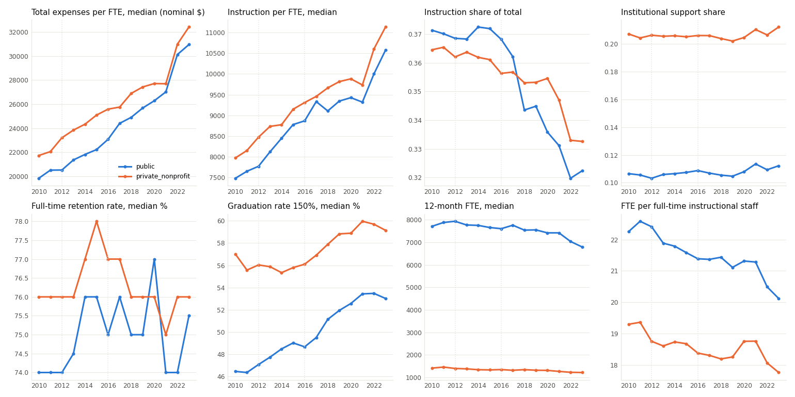
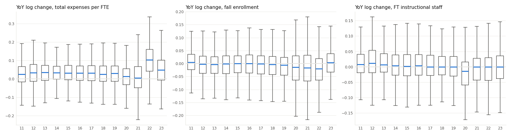

# FINANCE_DATA_AUDIT.md — модуль Finance, этап F1: данные IPEDS и аудит

Дата выгрузки: 2026-10-09. Источник: IPEDS Complete Data Files (NCES, `https://nces.ed.gov/ipeds/datacenter/data/<FILE>.zip`).
Код: `src/finance/` (`config.py`, `download.py`, `panel.py`, `audit.py`, `baseline.py`, `criterion.py`).
Данные: `data/finance/` (не в git); таблицы: `results/finance/`; графики: `docs/finance_audit/`.
Модели не обучались. Модули Academic и Research не затронуты.

## 0. Коротко

- **Панель:** 26 011 строк «вуз × год» за 2010–2023, 2 189 вузов (676 государственных, 1 521 частный некоммерческий), 1 793–1 893 вуза в год, 74 колонки.
- **Загрузка:** скачаны все 126 нужных файлов (9 компонент × 14 лет), пропусков нет. Если в архиве есть исправленная версия файла (`_rv`), берётся она.
- **Стипендии.** Категории расходов GASB и FASB совпадают по смыслу, кроме стипендий. У частных вузов (FASB) институциональные гранты почти целиком уходят в скидки с выручки за обучение, и медианная доля стипендий в расходах равна 0. У государственных она 4–5% (до 8% в 2022 году). Для сравнения между формами добавлены валовые стипендии из раздела о студенческой помощи (§3).
- **Методические разрывы:**
  - FY2016 — смена форм. Гипотеза о разрыве проверена: в медианах скачка нет.
  - FY2018 — стандарт GASB 75 (обязательства по медстраховке пенсионеров) у государственных вузов: рост расходов на преподавание 0.4% против 2–4% в обычные годы.
  - FY2020–2022 — COVID и федеральная помощь студентам (HEERF): стипендии у государственных вузов +24–32% в год, затем −47% в 2023.
  - 2016 — в retention появляются «включения» в когорту.
  - 2012 — реструктуризация отчётности о персонале (снята выбором единого источника, §6).
- **Полный ряд за все 14 лет** по всем четырём целям одновременно есть у 1 145 вузов, ряд от 10 лет — у 1 272.
- **Выбытие:** 306 вузов выбыли до 2023 года: 93 слились, 74 закрылись, 88 исчезли из IPEDS без пометки, 51 вышли за критерии отбора. Часть «слияний» — смена UNITID или отчётной структуры (Penn State в 2022, Virginia Tech в 2019).
- **Baseline.** «Средний рост по группе» почти не отличается от naive:

  | цель | выигрыш над naive |
  |---|---|
  | расходы на FTE | +2.7% |
  | приём | −0.1% |
  | выпускаемость | −0.4% |
  | retention | −3.4% |

  Ни один baseline не проходит зафиксированный критерий. При 1 500–2 000 вузах ДИ разницы узкий (1–2% от MAE naive), так что выигрыш в 10% будет надёжно различим.
- **Критерий успеха** зафиксирован в `src/finance/criterion.py` и закоммичен (`50a5002`) до любого baseline и любой модели.

## 1. Файлы и соглашение о годах

**Год панели Y = год сбора IPEDS.**

| компонент | файл IPEDS | что берётся | период данных |
|---|---|---|---|
| Справочник вуза | `HD{Y}` | название, штат, `CONTROL`, `ICLEVEL`, `HLOFFER`, `DEGGRANT`, Carnegie, `NEWID` / `CLOSEDAT` / `DEATHYR` | осень Y |
| Флаги головной / дочерний | `FLAGS{Y}` | `PRCH_F`, `IDX_F` | — |
| Осенний приём | `EF{Y}A` | `EFTOTLT` при `EFALEVEL = 1` (все студенты) | осень Y |
| Retention | `EF{Y}D` | `RET_PCF` (очные первокурсники, вернувшиеся на 2-й год) | осень Y |
| FTE | `EFIA{Y}` | `FTEUG + FTEGD + FTEDPP` (12-месячный FTE) | июль Y−1 – июнь Y |
| Выпускаемость | `GR{Y}` | `GRTOTLT` (`GRTYPE` 12) / `GRTOTLT` (`GRTYPE` 8) — бакалавры за 150% нормативного срока | когорта Y−6 |
| Финансы, государственные | `F{Y−1}{Y}_F1A` (GASB) | раздел C — расходы по функциям; раздел E — стипендии | FY, заканчивающийся в июне Y |
| Финансы, частные НКО | `F{Y−1}{Y}_F2` (FASB) | раздел E — расходы по функциям; раздел C — студенческие гранты | FY Y |
| Преподаватели | `EAP{Y}` | штатные преподаватели | осень Y |

12-месячный FTE и финансовый год покрывают один и тот же период (июль Y−1 – июнь Y), поэтому расходы на FTE согласованы по времени.

Манифест загрузки (имя файла, использованный CSV, признак исправленной версии, SHA1, дата) лежит в `data/finance/manifest.csv`.

**Чего нет:**
- Финансы за FY2024 (`F2324_*`) ещё не опубликованы, поэтому 2023 — последний год.
- Производные файлы IPEDS (`DRVGR`, `DRVEF`) за ранние годы отсутствуют, поэтому все показатели посчитаны из исходных файлов единообразно.

## 2. Фильтр выборки

Вуз входит в панель в году Y, если в `HD{Y}` выполнено:
- `ICLEVEL = 1` — четырёхлетний вуз;
- `CONTROL ∈ {1, 2}` — государственный или частный некоммерческий; коммерческие (3) не включены;
- `HLOFFER ≥ 7` — высшая программа магистерская или выше (7 магистр, 8 сертификат после магистратуры, 9 доктор);
- `DEGGRANT = 1` — присуждает степени;
- штат входит в 50 штатов или округ Колумбия; территории (PR, GU, VI и т.п.) исключены.

Фильтр применяется **по каждому году**: вуз, открывший магистратуру позже 2010 года, входит с этого года («entered scope», §9).

Группа сравнения `peer_group` = тип контроля × укрупнённая Carnegie Basic. Классификация берётся последняя доступная: 2021 → 2018 → 2015 → 2010; нумерация кодов в этих версиях совпадает.

| Carnegie | частные | государственные |
|---|---|---|
| R1 | 39 | 108 |
| R2 | 41 | 93 |
| D/PU | 145 | 32 |
| Master's L / M / S | 166 / 123 / 116 | 159 / 58 / 41 |
| Baccalaureate | 325 | 80 |
| Special focus | 503 | 46 |
| Unclassified / Other / Tribal | 63 | 59 |

## 3. Гармонизация GASB и FASB

| единая категория | GASB (F1A, государственные) | FASB (F2, частные НКО) |
|---|---|---|
| instruction | `F1C011` | `F2E011` |
| research | `F1C021` | `F2E021` |
| public service | `F1C031` | `F2E031` |
| academic support | `F1C051` | `F2E041` |
| student services | `F1C061` | `F2E051` |
| institutional support | `F1C071` | `F2E061` |
| scholarships (расход, как в отчёте) | `F1C101` — стипендии за вычетом скидок | `F2E081` — чистая помощь студентам |
| total expenses | `F1C191` — расходы и вычеты, всего | `F2E131` — расходы, всего |
| справочно: auxiliary, hospital, independent ops, other | `F1C111`, `F1C121`, `F1C131`, `F1C141` | `F2E071`, `F2E091`, `F2E101`, `F2E121` |
| **валовые стипендии** (гармонизированные) | `F1E07` | `F2C07` |
| скидки с выручки за обучение и вспомогательные службы | `F1E10` | `F2C10` (до 2015 года — `F2C08 + F2C09`) |
| натуральные статьи итога: O&M, амортизация, проценты | `F1C19OM` / `F1C19DP` / `F1C19IN` (до FY2015 `F1C196` / `F1C194` / `F1C197`) | `F2E134` / `F2E135` / `F2E136` |

**Различия форм и как они учтены.**

1. **Эксплуатация зданий (O&M), амортизация, проценты.**
   - В обеих формах эти затраты **распределены по функциям**. До FY2015 это видно в матрице «функция × натуральная статья», с FY2016 функции даются только итогом.
   - Проверено на данных: отдельная строка O&M (`F1C081` / `F2E111`) равна 0 у всех вузов, то есть всё распределено.
   - Перераспределять ничего не требуется. Сопоставимость функций до и после FY2016 подтверждается отсутствием скачка в медианах (§6).
2. **Стипендии.**
   - FASB отражает институциональные гранты в пределах стоимости обучения как скидку с выручки. В расход попадает только «чистая помощь» сверх выручки.
   - GASB тоже вычитает скидки, но в расход идёт заметная часть внешней помощи, например Pell, проходящий через вуз.
   - Итог: медианная доля стипендий в расходах у FASB равна 0, у GASB 4–5%. **«Стипендии как расход» между формами несравнимы.**
   - Гармонизированные показатели:
     - `exp_sch_gross` — валовые стипендии и гранты из всех источников, включая скидки; сопоставимо;
     - `exp_total_with_discounts` = итог расходов + скидки, то есть расходы так, как если бы скидки были расходом;
     - `sch_gross_share_of_total_with_discounts` — доля валовых стипендий в этих расходах. Медианы: частные 24–32%, государственные 14–19%.
3. **Итог расходов.** GASB «expenses and deductions» включает прочие вычеты, FASB «total expenses» — нет. Обе формы включают вспомогательные службы, **больницы** и независимые операции.
   - Поэтому `total_per_fte` у вузов с медцентрами огромен: до 10 млн $ на FTE у UT Health Science Center at Tyler и Rockefeller University.
   - Добавлен `exp_core_total` — сумма 7 категорий без вспомогательных служб, больниц и прочего.
4. **Пенсии и медстраховка пенсионеров у государственных вузов.** GASB 68 (пенсии, с FY2015) и GASB 75 (OPEB, с FY2018) меняют начисление расходов на льготы, которые распределены по функциям.
   - В FY2018 медианный рост расходов на преподавание на FTE у государственных вузов 0.4% против 2.1% у частных; доля преподавания падает с 0.363 до 0.347.
   - В FY2015 эффект в медианах не виден.
   - Пересчёт не делался: это начисления, а не денежные потоки, и признак методики, а не ошибка. Годы помечены в §6.
5. **9–21 государственный вуз ежегодно отчитывается по FASB.** Они оставлены, форма хранится в `finance_form`. Смен формы у одного вуза за 2010–2023 — 4.
6. **Головной и дочерний кампусы** (`PRCH_F`).
   - Дочерние кампусы, у которых финансы целиком в отчёте головного вуза (`PRCH_F = 2`, 625 строк), — расходы обнулены в NaN.
   - Их 12-месячный FTE добавлен к FTE головного вуза (`fte_finance_basis`, 383 строки). Иначе расходы на FTE у головного были бы завышены.
   - Частичные дочерние (`PRCH_F ∈ {3, 5, 6}`) помечены `finance_partial` и оставлены как есть.
7. **Деньги номинальные.** Рост расходов на FTE в 2022 году (+10%) во многом инфляция. Дефлятор (CPI-U или HEPI) не применялся — это решение для этапа моделей.

**Расходы на студента:** `<категория>_per_fte = exp / fte_finance_basis`. **Доли:** `<категория>_share = exp / exp_total`.

## 4. Размер панели и покрытие

| год | частные НКО | государственные | всего |
|---|---|---|---|
| 2010 | 1 207 | 586 | 1 793 |
| 2013 | 1 236 | 600 | 1 836 |
| 2016 | 1 277 | 606 | 1 883 |
| 2019 | 1 270 | 615 | 1 885 |
| 2023 | 1 282 | 601 | 1 883 |

Финансы по формам за год: 1 155–1 232 частных по FASB, 560–579 государственных по GASB, 5–21 государственный по FASB. У 61–85 вузов в год финансов нет: это дочерние кампусы или неотчитавшиеся.

## 5. Пропуски (% строк за год)

| показатель | 2010 | 2012 | 2015 | 2018 | 2020 | 2021 | 2023 |
|---|---|---|---|---|---|---|---|
| fall_enrollment | 3.2 | 2.9 | 3.3 | 3.2 | 4.3 | 3.3 | 3.2 |
| fte_total | 3.2 | 2.7 | 3.0 | 3.1 | 3.9 | 3.2 | 3.0 |
| retention_rate | 24.1 | 23.5 | 24.0 | 23.8 | 23.9 | 22.4 | 22.0 |
| grad_rate_150 | 26.3 | 25.4 | 25.2 | 25.5 | 24.7 | 23.8 | 23.7 |
| faculty_ft_instructional | 4.6 | 3.6 | 3.8 | 4.1 | 4.9 | 4.1 | 5.6 |
| exp_total | 4.1 | 3.7 | 4.1 | 4.3 | 4.4 | 3.3 | 3.6 |
| total_per_fte | 6.3 | 5.9 | 6.0 | 6.2 | 6.3 | 5.3 | 5.6 |

- **Retention и выпускаемость отсутствуют у ~23–26% строк структурно.** Это вузы только с магистратурой или докторантурой и узкопрофильные школы без когорты очных первокурсников-бакалавров. Это не пропуски данных: моделировать эти цели нужно только для вузов с бакалавриатом.
- **Расходы на FTE пропущены чаще итога расходов** (6% против 4%), потому что у дочерних кампусов и вузов без FTE знаменатель недоступен.
- **Пропусков внутри ряда мало:** у 25 вузов есть пропущенные годы между первым и последним присутствием.

## 6. Разрывы из-за смены форм и методик

Медианное изменение год к году: для расходов и численности — логарифм отношения, для retention и выпускаемости — п.п. Формат ячеек: частные / государственные.

| год | расходы на FTE | преподавание на FTE | стипендии на FTE (как расход) | FTE | штатные преподаватели | retention, п.п. | выпускаемость, п.п. |
|---|---|---|---|---|---|---|---|
| 2012 | .042 / .020 | .040 / .016 | −.016 / −.055 | .002 / .004 | .015 / .010 | 0 / 0 | .10 / .53 |
| 2015 | .035 / .029 | .029 / .030 | .042 / .000 | −.005 / .003 | 0 / .006 | 0 / 0 | .27 / .41 |
| **2016** | .032 / .032 | .026 / .024 | .041 / −.003 | −.002 / .006 | 0 / .011 | 0 / 0 | .43 / .18 |
| **2018** | .025 / .024 | .021 / **.004** | .040 / .034 | −.001 / .005 | 0 / .010 | 0 / 0 | .68 / 1.32 |
| 2020 | .003 / .030 | .005 / .017 | **.105 / .237** | −.004 / −.006 | **−.019** / −.009 | 0 / 1 | −.04 / .62 |
| 2021 | .002 / .007 | −.012 / 0 | **.149 / .124** | −.015 / −.016 | 0 / −.010 | **−1 / −2** | .03 / .51 |
| 2022 | **.104 / .097** | .068 / .069 | **.356 / .325** | −.021 / −.033 | 0 / −.004 | 0 / 0 | −.08 / −.13 |
| 2023 | .050 / .045 | .053 / .058 | **−.129 / −.468** | −.012 / −.012 | 0 / .005 | 0 / 0 | −.30 / .00 |

Полная таблица по всем годам: `results/finance/audit_tables.md`, раздел `breaks_median_yoy`.




| год | изменение | эффект в данных | что делать |
|---|---|---|---|
| FY2016 | новые финансовые формы GASB и FASB: функции без матрицы натуральных статей | скачка нет (рост расходов на FTE 3.2% / 3.2%) | ничего; при необходимости флаг `fy >= 2016` |
| FY2015 | GASB 68 (пенсии), только государственные | в медианах не виден | флаг года |
| **FY2018** | **GASB 75 (OPEB), только государственные** | рост расходов на преподавание 0.4% против ~2–4%; падение доли преподавания | флаг года; dummy в моделях расходов |
| 2012 | реструктуризация отчётности о персонале (новые категории EAP; S_IS вместо S_F) | по EAP ряд непрерывен (+1.5% / +1.0%); источник S_IS дал бы 47–53% пропусков в чётные годы, S_F 2010–2011 — другую категорию | используется EAP за все годы (§1) |
| 2012 | в EFIA доктора профессиональной практики выделены в `FTEDPP` | FTE магистратуры падает на ~24%, но сумма `FTEGD + FTEDPP` непрерывна (отношение 0.99) | общий FTE = сумма трёх частей |
| 2016 | в retention появились «включения» в когорту (`RRFTIN`) | медианы не меняются | флаг |
| FY2020–2022 | COVID; HEERF — экстренные гранты студентам, учтены как стипендии | стипендии на FTE +24–36% в год, в 2023 −13% / −47%; расходы на FTE: рост около 0 в 2020–2021, +10% в 2022 | флаг COVID-лет; для стипендий использовать валовые и осторожно |
| 2020–2021 | COVID: retention и приём | retention у государственных +1 п.п. в 2020 и −2 п.п. в 2021; приём −1.5…−3% в год с 2021; ошибка naive по retention растёт с 4.5 до 6.2 п.п. | отдельная проверка устойчивости моделей на 2020–2022 |
| 2022 | Penn State перешла на отчётность по кампусам | «слияние» головного UNITID в Main Campus | ряд Penn State с разрывом (§9) |

## 7. Выбросы

| проверка | строк | вузов |
|---|---|---|
| расходы на FTE вне 0.5–99.5 перцентиля | 246 | 63 |
| FTE < 100 | 1 626 | 254 |
| итог расходов ≤ 0 | 9 | 2 |
| какая-либо категория < 0 | 6 | 6 |
| сумма 7 категорий > итог × 1.01 (доли в сумме > 1) | 53 | 33 |
| retention ровно 0 или 100 | 401 | 149 |
| выпускаемость ровно 0 или 100 | 120 | 79 |
| когорта выпускаемости < 30 | 1 458 | 261 |
| FTE на штатного преподавателя > 100 | 385 | 95 |
| \|изменение год к году\| расходов на FTE > 0.5 (лог) | 355 | 245 |
| \|изменение год к году\| приёма > 0.5 (лог) | 217 | 147 |
| \|изменение год к году\| retention > 20 п.п. | 570 | 232 |
| \|изменение год к году\| выпускаемости > 20 п.п. | 454 | 218 |

**Откуда они берутся:**
- **Экстремальные расходы на FTE** — медицинские и научные центры с десятками студентов: UT HSC Tyler до 10.4 млн $ на FTE, Rockefeller University 6.8 млн $. Решение — `exp_core_total` или исключение вузов с FTE < 100 / special focus «medical».
- **Retention и выпускаемость 0 / 100 и скачки >20 п.п.** — маленькие когорты (1 458 строк с когортой < 30). Для моделей нужен вес по размеру когорты или порог.
- **Сумма категорий больше итога** — в основном GASB-вузы с отрицательными «прочими вычетами».

## 8. Число вузов с полным рядом

| показатель | вузов хотя бы с 1 годом | все 14 лет | ≥ 10 лет |
|---|---|---|---|
| retention_rate | 1 683 | 1 199 | 1 313 |
| grad_rate_150 | 1 654 | 1 158 | 1 285 |
| fall_enrollment | 2 118 | 1 501 | 1 656 |
| total_per_fte | 2 043 | 1 474 | 1 618 |
| faculty_ft_instructional | 2 111 | 1 478 | 1 643 |
| **все 4 цели одновременно** | 1 602 | **1 145** | 1 272 |

## 9. Слияния, закрытия, появление

Причина выбытия определялась по `NEWID`, `CLOSEDAT` и `DEATHYR` в `HD` последнего года вуза в панели или в следующие годы.

| причина выбытия до 2023 | вузов |
|---|---|
| слился (`NEWID` указывает на другой UNITID) | 93 |
| закрылся (`CLOSEDAT`) | 74 |
| исчез из IPEDS без пометки | 88 |
| вышел за критерии отбора (сменил уровень, тип или высшую программу) | 51 |
| **всего** | **306** |

По годам: выбытие растёт с 2015 года, пик слияний в 2018–2020 (12–15 в год), пик закрытий в 2019 и 2021 (по 10). Таблица `exits_by_year` в `results/finance/audit_tables.md`.

**Появление:**
- 261 вуз вошёл в выборку позже 2010 года, потому что открыл магистратуру или изменил тип;
- 135 вузов новые в IPEDS.

**Осторожно со «слияниями».** Часть из них — смена UNITID или отчётной структуры, а не реальное слияние:
- Penn State в 2022 году: головной UNITID → Main Campus;
- Virginia Tech в 2019 году: смена UNITID;
- филиалы Purdue Global, Antioch, Averett, LIU присоединены к головным.

Для моделей нужен переходный ключ: склеивать ряды по `NEWID` или исключать год смены. Список: `results/finance/entries_exits.csv`.

## 10. Baseline без ML

**Схема.** Rolling origin, origins 2014–2022, горизонт 1 год, цели 2015–2023. Нужны два подряд идущих года.
- **naive:** значение прошлого года (для приёма и расходов на FTE это нулевой рост).
- **Средний рост по группе:** значение прошлого года плюс среднее изменение в `peer_group` за последний известный год (t−1 → t).
  - Группы минимум из 5 вузов.
  - Изменения обрезаны: ±1.0 по логарифму для счётчиков и расходов, ±20 п.п. для долей.
  - Используется только информация, известная на момент прогноза.
- **Ошибка:** п.п. для retention и выпускаемости, |log(ŷ / y)| для приёма и расходов на FTE.
- **Bootstrap:** 2 000 ресэмплов вузов.

| цель | точек | вузов | MAE naive | MAE «группа» | выигрыш над naive | 95% ДИ разницы | ширина ДИ, % от naive | вузов, где «группа» лучше | критерий |
|---|---|---|---|---|---|---|---|---|---|
| retention_rate, п.п. | 12 609 | 1 569 | 5.75 | 5.95 | −3.4% | [+0.16; +0.23] | 1.2% | 501 | ❌ |
| grad_rate_150, п.п. | 12 330 | 1 540 | 5.11 | 5.13 | −0.4% | [+0.005; +0.037] | 0.6% | 762 | ❌ |
| fall_enrollment, лог-рост | 15 961 | 1 986 | 0.0838 | 0.0839 | −0.1% | [−0.0006; +0.0008] | 1.7% | 1 028 | ❌ |
| total_per_fte, лог-рост | 15 559 | 1 927 | 0.0972 | 0.0946 | +2.7% | [−0.0034; −0.0018] | 1.6% | 1 124 | ❌ (выигрыш < 10%) |

MAE naive по годам целей:

| год | retention, п.п. | выпускаемость, п.п. | приём, лог | расходы на FTE, лог |
|---|---|---|---|---|
| 2015 | 4.32 | 4.59 | 0.067 | 0.081 |
| 2019 | 4.50 | 4.41 | 0.066 | 0.076 |
| 2020 | 5.33 | 4.37 | 0.079 | 0.072 |
| 2021 | **6.19** | 4.22 | 0.077 | 0.092 |
| 2022 | 4.96 | 4.20 | 0.070 | **0.135** |
| 2023 | 4.78 | 4.07 | 0.073 | 0.095 |

Выводы:
- **Средний рост группы почти ничего не добавляет к naive.** Изменения внутри вуза доминируют над общим трендом группы. Немного помогает он только для расходов на FTE (общая инфляция затрат): у государственных R1, R2 и Master's MAE ниже на 6–13%.
- **Мощность высокая.** ДИ разницы занимает 0.6–1.7% от MAE naive, поэтому выигрыш в 10% (порог критерия) будет надёжно отличим от нуля. В отличие от Research с 13 вузами, здесь ограничение не в мощности, а в самом сигнале.
- **Ошибка naive резко растёт в годы COVID** (retention 2021, расходы 2022). Модели стоит оценивать и на всех годах, и отдельно без 2020–2022.

## 11. Критерий успеха для будущих моделей (зафиксирован до моделей)

`src/finance/criterion.py`, коммит `50a5002` — раньше, чем запускались baseline и любые модели.

Модель лучше naive по цели, если:
1. MAE ниже naive хотя бы на 10%: `1 − mean_i MAE_i(модель) / mean_i MAE_i(naive) ≥ 0.10`;
2. 95% bootstrap-ДИ разницы `mean_i [MAE_i(модель) − MAE_i(naive)]` при ресэмплинге вузов целиком ниже 0.

Ошибки и схема те же, что в §10: п.п. для retention и выпускаемости, |log(ŷ / y)| для приёма и расходов на FTE, rolling origin 2014–2022, горизонт 1 год, одинаковые вузы и годы для модели и naive.

## 12. Что решить перед этапом моделей

1. **Расходы:** `total_per_fte` (как в зафиксированном критерии, включает больницы и вспомогательные службы) или `core_total_per_fte` (7 категорий). Рекомендую core: меньше выбросов от медцентров. Смена цели — отдельным коммитом критерия до моделей.
2. **Деньги:** номинальные или реальные; если реальные, то CPI-U или HEPI.
3. **Выборка для retention и выпускаемости:** только вузы с бакалавриатом и когортой ≥ 30, или вес по размеру когорты.
4. **COVID-годы 2020–2022:** флаг и отдельная оценка; GASB 75 в FY2018 — флаг для государственных.
5. **Смена UNITID и отчётной структуры:** склеивать по `NEWID` (Penn State, Virginia Tech и т.п.) или обрывать ряд.
6. **Стипендии:** для сравнения частных и государственных вузов использовать валовые (`sch_gross_*`), а не «стипендии как расход».

## 13. Воспроизведение

```bash
python -m src.finance.download   # ~1.1 ГБ CSV в data/finance/raw (126 файлов), кэш на диск, повторы при ошибках
python -m src.finance.panel      # data/finance/panel.parquet (26 011 × 74), institutions.parquet (HD всех лет)
python -m src.finance.audit      # results/finance/audit_tables.md, entries_exits.csv; docs/finance_audit/*.png
python -m src.finance.baseline   # results/finance/baseline_*.csv
```

## 14. Решения по F1 (2026-10-09) и пересчитанный baseline

Критерий пересмотрен и закоммичен до любых моделей: `src/finance/criterion.py`, коммит `5b7e141`.

1. **Цель по расходам — `core_total_per_fte_real`.**
   - Это сумма 7 гармонизированных категорий на FTE без вспомогательных служб, больниц, независимых операций и прочего.
   - Пересчитана в доллары FY2023.
2. **Реальные деньги.**
   - Индекс: CPI-U, все товары, без сезонной поправки (FRED `CPIAUCNS`, `data/finance/raw/CPIAUCNS.csv`).
   - Берётся среднее за финансовый год июль–июнь.
   - Множитель к долларам FY2023 = CPI(FY2023) / CPI(FY): 1.383 для FY2010, 1.266 для FY2015, 1.165 для FY2020, 1.063 для FY2022.
   - Медиана core-расходов на FTE: 17,680 $ номинально в FY2010, то есть 24,447 $ в долларах 2023 → 26,860 $ в FY2023. В реальных деньгах рост за 13 лет около 10%.
   - Реальные версии добавлены для всех категорий: `*_per_fte_real`.
3. **Retention и выпускаемость — только вузы с бакалавриатом и когортой ≥ 30.**
   - «С бакалавриатом» = вуз хотя бы в одном году сообщает когорту бакалавров в GR (`GRTYPE` 8).
   - Когорта: `RRFTCTA` для retention, когорта `GRTYPE` 8 для выпускаемости.
   - Допустимы 71% и 70% строк панели (флаги `eligible_retention`, `eligible_grad`).
4. **Флаги и отдельная оценка.**
   - `flag_covid`: целевые годы 2020–2022.
   - `flag_gasb75`: государственный вуз и целевой год 2018.
   - Каждая оценка даётся дважды: «все годы» и «без помеченных».
5. **UNITID** (`data/finance/id_events.csv`):

   | тип события | случаев | что делается |
   |---|---|---|
   | смена ID у того же вуза: один предшественник, преемник начинается в год смены или на следующий | 4 | ряды **склеены** в `series_id`; пустой год старого ID помечен `superseded`; год перехода — `id_transition` и не используется в оценке |
   | несколько вузов слились в новый UNITID (Augusta University, Kennesaw State 2015, Pennsylvania Western и Commonwealth University 2022) | 24 | ряды предшественников **обрываются**; первый год нового вуза — `id_transition` |
   | смена отчётности: филиал или кампус ушёл в существующий головной вуз с тем же названием (Purdue Global, USF, Penn State, Virginia Tech) | 26 | ряд филиала обрывается; год перехода у головного — `id_transition` |
   | реальное слияние с существующим вузом | 43 | поглощённый ряд **обрывается**; год поглощения у преемника — `merger_absorption`, рост в этот год не оценивается |

   Склеивать в один ряд можно только при смене ID: при смене отчётности и слияниях преемник уже имеет собственную историю, и склейка дала бы два значения за один год.
6. **`ACADEMIC_AUDIT.md`** закоммичен отдельно.

**Baseline по новым правилам** (rolling origin 2014–2022, сущность — `series_id`):

| цель | оценка | точек | рядов | MAE naive | MAE «группа» | выигрыш над naive | 95% ДИ разницы | критерий |
|---|---|---|---|---|---|---|---|---|
| core_total_per_fte_real  лог-рост | все годы | 15 509 | 1 925 | 0.09221 | 0.0942 | -2.2% | [+0.0014; +0.0026] | ❌ |
| core_total_per_fte_real  лог-рост | без помеченных | 9 805 | 1 916 | 0.08894 | 0.09209 | -3.5% | [+0.0025; +0.0039] | ❌ |
| fall_enrollment  лог-рост | все годы | 15 917 | 1 985 | 0.08403 | 0.08415 | -0.1% | [-0.0006; +0.0008] | ❌ |
| fall_enrollment  лог-рост | без помеченных | 10 069 | 1 976 | 0.0813 | 0.0826 | -1.6% | [+0.0005; +0.0021] | ❌ |
| grad_rate_150  п.п. | все годы | 11 564 | 1 429 | 3.71 | 3.722 | -0.3% | [-0.0018; +0.0267] | ❌ |
| grad_rate_150  п.п. | без помеченных | 7 198 | 1 420 | 3.722 | 3.717 | +0.1% | [-0.0237; +0.0115] | ❌ |
| retention_rate  п.п. | все годы | 11 634 | 1 424 | 3.905 | 4.1 | -5.0% | [+0.1752; +0.2149] | ❌ |
| retention_rate  п.п. | без помеченных | 7 261 | 1 418 | 3.605 | 3.684 | -2.2% | [+0.0634; +0.0944] | ❌ |

Выводы:
- **Фильтр по бакалавриату и когорте ≥ 30 снижает шум:** ошибка naive по retention падает с 5.7 до 3.9 п.п., по выпускаемости с 5.1 до 3.7 п.п.
- **В реальных деньгах «средний рост группы» хуже naive** (−2…−4%): типичный реальный рост расходов около нуля, и прибавка группового тренда в основном добавляет шум.
- **Без помеченных лет ошибки naive ниже,** но вывод тот же: ни один baseline критерий не проходит.

Цифры в §0 и §10 относятся к прежней цели (`total_per_fte`, номинальные деньги, без фильтра) и оставлены для истории; действующие baseline — в этой таблице.
