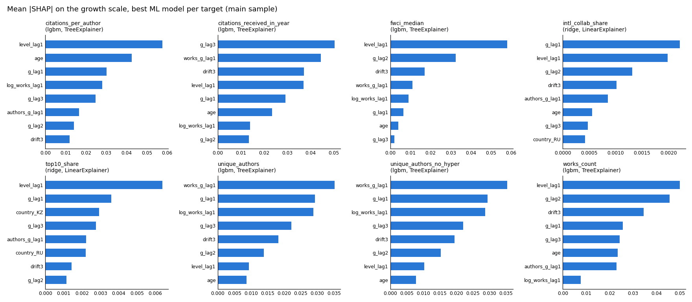

# STAGE2_REPORT.md — прогноз роста научных показателей вузов на 1 год

Дата: 2026-10-09. Данные: `data/research/panel.parquet` (OpenAlex, выгрузка 2026-10-09), см. `DATA_AUDIT.md`.
Код: `src/research/stage2_config.py` (дизайн и критерий), `src/research/stage2.py` (оценка), `src/research/sdu_check.py`.
Результаты: `results/research/stage2/*.csv` (не в git).

## 0. Итог

Критерий успеха зафиксирован в коде **до** первого запуска моделей (коммит `f943043`, `stage2_config.py`). Модель считается лучше naive, если одновременно:
1. MAE на шкале роста хотя бы на 10% ниже, чем у naive;
2. 95% bootstrap-ДИ разницы MAE (ресэмплинг по вузам) целиком ниже 0.

Основная выборка: 13 вузов (SDU исключён до проверки аффилиаций, §2), origins 2018–2024, горизонт 1 год.

| цель | rolling-origin | leave-one-university-out | вывод |
|---|---|---|---|
| `works_count` | ✅ Ridge +27%, LightGBM +27% | ✅ Ridge +24% (граница ДИ на нуле), ❌ LightGBM | **проходит на грани** |
| `unique_authors` | ✅ Ridge +35%, LightGBM +35% | ✅ Ridge +34%, LightGBM +33% | **проходит** |
| `citations_received_in_year` | ✅ все три (drift +27%, Ridge +52%, LightGBM +54%) | ✅ все три | **проходит уверенно** |
| `citations_per_author` | ❌ лучшая LightGBM +13%, ДИ [−5%; +32%] | ❌ | **не проходит** |
| `intl_collab_share` | ❌ naive лучше всех | ❌ | **не проходит** |
| `top10_share` (основная цель качества) | ❌ naive лучше всех | ❌ | **не проходит** |
| `fwci_median` (дополнительная цель качества) | ❌ | ❌ | **не проходит** |
| `unique_authors_no_hyper` (вариант) | ✅ как `unique_authors` | ✅ | совпадает с `unique_authors` |

Что это значит:
- **Счётчики** (работы, авторы, цитаты). Прогноз роста предсказуемо лучше, чем «как в прошлом году». Но выигрыш сосредоточен у быстрорастущих вузов. У зрелых вузов с плато (UNIST, Skoltech, Innopolis, KIMEP, а по числу работ и NU) naive точнее моделей (§5).
- **Доли** (международность, top-10%, FWCI). Ни одна модель не обыгрывает naive. Мощности хватает, чтобы заметить выигрыш порядка 10–13% (§4.3), но его нет. Лучший прогноз долей на год вперёд — значение прошлого года.

## 1. Дизайн (зафиксирован до запуска)

**Цели.** Модели предсказывают рост, а не уровень:
- для счётчиков `g_t = log(y_t / y_{t-1})`: `works_count`, `unique_authors`, `unique_authors_no_hyper`, `citations_received_in_year` (с 2012), `citations_per_author`;
- для долей и медианного FWCI `g_t = y_t − y_{t-1}`: `intl_collab_share`, `top10_share`, `fwci_median`.

Прогноз уровня: `ŷ_t = y_{t-1}·exp(ĝ)` или `y_{t-1} + ĝ`. `fwci_mean` из целей убран.

**Модели.**
1. naive: `ĝ = 0`.
2. naive + drift: средний рост за 3 прошлых года.
3. Ridge: стандартизация признаков, `alpha ∈ {0.1, 1, 10, 100, 1000}`.
4. LightGBM: `max_depth=2`, `num_leaves=3`, `learning_rate=0.05`, `subsample` и `colsample` = 0.8; сетка `n_estimators ∈ {50, 150}`, `min_child_samples ∈ {10, 20}`, `reg_lambda ∈ {1, 10}`.

Ridge и LightGBM — общие (pooled) модели по всем вузам. Prophet и нейросети не используются.

**Признаки** (всё известно на конец года t−1):
- рост цели с лагами 1–3 и drift3;
- уровень цели в t−1 (логарифм для счётчиков);
- размер: `log works_count` в t−1;
- рост числа работ и рост числа авторов в t−1 (кроме случая, когда это и есть цель);
- возраст ряда: лет с первой публикации вуза в OpenAlex;
- страна (one-hot: KZ, RU, KR, AE).

`uni_type` в признаки **не входит**.

**Ряды.**
- Ряд вуза начинается с первого года, где ≥10 работ. Для цитат дополнительно не раньше 2012.
- Строка нужна с тремя лагами роста, то есть 4 предыдущих года уровня. Поэтому у AITU и MBZUAI (ряды с 2020) первый оцениваемый год — 2024, у них по 2 точки.
- Отозванные работы и paratext исключены из всех признаков: 216 и 176 работ за 2010–2025, только по кэшу, без новых запросов.

**Оценка.** Две схемы:
- **rolling-origin**: для каждого origin `o ∈ 2018…2024` модель обучается на строках с целевым годом ≤ o и прогнозирует o+1;
- **leave-one-university-out (LOUO)**: то же, но тестовый вуз целиком исключён из обучения.

**Вложенная настройка.** Гиперпараметры выбираются внутри обучающей части: внутренние origins o−3…o−1, минимум MAE роста. Тестовые годы в выборе не участвуют. Выбранные параметры по origins сохранены в `predictions_all_origins.csv` (колонка `params`).

**Метрики** (по каждому вузу, затем макро-среднее):
- **MAE роста** (основная): `|log ŷ − log y|` для счётчиков, `|ŷ − y|` для долей. Эта шкала не зависит от размера вуза, поэтому вузы разного масштаба сопоставимы.
- **MAE уровня** и **sMAPE** уровня.
- **MASE = MAE_уровня(модель) / MAE_уровня(naive)** по вузу; агрегат — геометрическое среднее.

**Bootstrap.** 10 000 ресэмплов вузов с возвращением. Для каждого считаются ДИ разницы `mean_u MAE(модель) − mean_u MAE(naive)` и ДИ относительного выигрыша.

**Оценка качества публикаций.**
- Основная: целевые годы ≤ 2023, то есть origins ≤ 2022, у работ минимум 2 года цитирования.
- 2024–2025 вынесены отдельной строкой как предварительные.

**Сценарии.**
- `main`: SDU исключён, KBTU 2021 оставлен.
- `sens_no_kbtu2021`: из обучения и оценки убраны все строки, чьё окно t−4…t задевает KBTU 2021.
- `sens_with_sdu`: SDU 2017–2025 включён.

## 2. Решения по данным

| решение | как выполнено |
|---|---|
| SDU: исключить 2010–2016 | сделано (`EXCLUDE_YEARS`) |
| SDU 2017–2025: только при нормальной доле турецких соавторов | **в основной выборке SDU нет**, см. ниже; включение SDU проверено как отдельный сценарий |
| Satbayev без дочернего института | не включён; ограничение в §8 |
| отозванные работы и paratext | исключены из всех признаков по кэшу `works/*.parquet` (поля `is_retracted` и `is_paratext` там есть) |
| `fwci_mean` убран; качество = `top10_share` + `fwci_median` | сделано |
| `unique_authors` без работ со 100+ авторами | `unique_authors_no_hyper`; отличие ≤0.3% по сумме за все годы |
| `uni_type` | заполнен в `institutions.py::UNI_TYPES`, используется только в §7 |

**SDU.** Доля работ SDU с турецкими соавторами по годам и сравнение с другими вузами Казахстана (`tr_coauthor_share_kz.csv`):

| | 2017 | 2018 | 2019 | 2020 | 2021 | 2022 | 2023 | 2024 | 2025 |
|---|---|---|---|---|---|---|---|---|---|
| SDU | 0.53 | 0.38 | 0.31 | 0.35 | 0.25 | 0.27 | 0.33 | 0.34 | 0.30 |
| максимум у 9 других вузов Казахстана | 0.05 | 0.02 | 0.02 | 0.03 | 0.06 | 0.05 | 0.03 | 0.08 | 0.04 |

- **По буквальному критерию «доля турецких соавторов в норме» SDU не проходит:** доля в 4–19 раз выше, чем у других казахстанских вузов. Поэтому SDU исключён из основной выборки.
- **Высокая доля может быть и настоящей:** SDU основан при участии Турции, и турецкие преподаватели там обычны. Отличить настоящие связи от ошибочной привязки может только проверка по сырым строкам аффилиаций авторов SDU. Это `python -m src.research.sdu_check`, около 20 кредитов OpenAlex. Правило решения зафиксировано в `SDU_RULE`: SDU включается, если «только турецких» работ ≤5% за 2017–2025 и ≤10% в каждом году.
- **Сегодня проверку запустить нельзя:** дневной лимит OpenAlex исчерпан, сброс в 00:00 UTC.
- **На выводы этапа включение SDU не влияет** (сценарий `sens_with_sdu`, §4.4).

## 3. Основные результаты: main, rolling-origin

В каждой ячейке: выигрыш MAE роста над naive, [95% ДИ выигрыша], число вузов, где модель лучше naive. ✅ — критерий успеха выполнен.

| цель | схема | drift | Ridge | LightGBM |
|---|---|---|---|---|
| works_count | rolling | +4% [−44; +36], 7/13 | +27% [+2; +46], 8/13 ✅ | +27% [+3; +45], 8/13 ✅ |
| works_count | LOUO | +4% [−47; +36], 7/13 | +24% [+0; +42], 8/13 ✅ | +24% [−1; +43], 8/13 |
| unique_authors | rolling | +16% [−8; +38], 8/13 | +35% [+16; +48], 10/13 ✅ | +35% [+13; +51], 9/13 ✅ |
| unique_authors | LOUO | +16% [−7; +38], 8/13 | +34% [+15; +48], 10/13 ✅ | +33% [+10; +49], 10/13 ✅ |
| intl_collab_share | rolling | −21% [−32; −12], 2/13 | −3% [−15; +6], 5/13 | −13% [−31; −1], 4/13 |
| intl_collab_share | LOUO | −21% [−32; −11], 2/13 | −2% [−12; +7], 6/13 | −14% [−34; −1], 4/13 |
| top10_share (≤2023) | rolling | −31% [−51; −13], 2/11 | −6% [−18; +3], 4/11 | −6% [−16; +4], 3/11 |
| top10_share (≤2023) | LOUO | −31% [−51; −13], 2/11 | −4% [−22; +8], 4/11 | −8% [−23; +3], 3/11 |
| citations_received_in_year | rolling | +27% [+12; +46], 11/13 ✅ | +52% [+34; +68], 13/13 ✅ | +54% [+40; +67], 12/13 ✅ |
| citations_received_in_year | LOUO | +27% [+12; +47], 11/13 ✅ | +49% [+29; +66], 12/13 ✅ | +54% [+39; +67], 12/13 ✅ |
| citations_per_author | rolling | −7% [−30; +14], 6/13 | +6% [−10; +23], 6/13 | +13% [−5; +32], 7/13 |
| citations_per_author | LOUO | −7% [−30; +14], 6/13 | +5% [−13; +21], 7/13 | +13% [−4; +29], 8/13 |
| fwci_median (≤2023) | rolling | −14% [−32; −1], 2/11 | +0% [−12; +13], 6/11 | +5% [−11; +16], 7/11 |
| fwci_median (≤2023) | LOUO | −14% [−33; −1], 2/11 | +7% [−16; +18], 7/11 | −16% [−42; +2], 4/11 |
| unique_authors_no_hyper | rolling | +16% [−8; +38], 8/13 | +35% [+15; +48], 10/13 ✅ | +35% [+14; +51], 9/13 ✅ |
| unique_authors_no_hyper | LOUO | +16% [−8; +38], 8/13 | +34% [+15; +48], 10/13 ✅ | +32% [+10; +48], 10/13 ✅ |

Ошибка самого naive (обе схемы совпадают):

| цель | вузов | прогнозов | MAE роста | sMAPE уровня, % |
|---|---|---|---|---|
| works_count | 13 | 81 | 0.227 | 22.4 |
| unique_authors | 13 | 81 | 0.219 | 21.7 |
| intl_collab_share | 13 | 81 | 0.042 (4.2 п.п.) | 11.1 |
| top10_share (≤2023) | 11 | 55 | 0.025 (2.5 п.п.) | 18.2 |
| citations_received_in_year | 13 | 81 | 0.349 | 34.1 |
| citations_per_author | 13 | 81 | 0.209 | 20.6 |
| fwci_median (≤2023) | 11 | 55 | 0.140 | 62.3 |

Для top-10% и FWCI в основной оценке 11 вузов, а не 13: у AITU и MBZUAI нет целевых лет ≤2023 с тремя лагами.

Лучшая модель по каждой цели (main, rolling, MAE роста):

| цель | модель |
|---|---|
| works_count, unique_authors, citations_received_in_year, citations_per_author, fwci_median | LightGBM |
| intl_collab_share, top10_share | **naive** |

Среди ML-моделей для долей лучше Ridge.

## 4. Надёжность выводов

### 4.1 Предварительные годы качества (целевые 2024–2025, 13 вузов, 26 точек)

| цель | схема | Ridge | LightGBM | успех |
|---|---|---|---|---|
| top10_share | rolling | −1%, 5/13 | +6% [ДИ разницы −0.007; +0.002], 7/13 | ❌ |
| top10_share | LOUO | +2%, 6/13 | −1%, 6/13 | ❌ |
| fwci_median | rolling | +6%, 7/13 | +3%, 7/13 | ❌ |
| fwci_median | LOUO | +6%, 8/13 | −8%, 6/13 | ❌ |

Вывод тот же: по качеству модели не лучше naive.

### 4.2 KBTU 2021

- В основной оценке точка оставлена. В 2021 году число работ выросло в 2.5 раза (103 → 256, рост по логарифму 0.91), в 2022-м упало до 182 (−29%).
- Все модели в 2021 году предсказали рост 0.17–0.21 по логарифму (+18–23%), а в 2022-м — продолжение роста 0.21–0.42 (+23–53%). Точка «бьёт» по всем моделям одинаково.
- Без неё (`sens_no_kbtu2021`, 76 прогнозов вместо 81):
  - `works_count` в rolling проходит лучше (Ridge +27% [+1; +45], LightGBM +28% [+2; +46]);
  - в LOUO не проходит (Ridge +25% [−1; +43], LightGBM +24% [−4; +44]).
- По остальным целям выводы не меняются.

### 4.3 Мощность: ширина ДИ разницы с naive

Ширина ДИ показана в процентах от MAE naive, rolling. Половина ширины — это примерно тот наименьший выигрыш, который можно было бы надёжно отличить от нуля на 13 вузах.

| цель | ширина ДИ, % от naive (Ridge / LightGBM) | различимый выигрыш, ≈ |
|---|---|---|
| works_count | 50 / 51 | ~25% |
| unique_authors | 44 / 49 | ~22–25% |
| citations_received_in_year | 47 / 44 | ~22–23% |
| citations_per_author | 33 / 38 | ~17–19% |
| intl_collab_share | 20 / 26 | ~10–13% |
| top10_share | 19 / 18 | ~9–10% |
| fwci_median | 24 / 27 | ~12–14% |

Следствия:
- **Счётчики.** Выигрыши в 24–35% едва перекрывают порог различимости. Поэтому `works_count` в LOUO колеблется на границе ДИ: при 13 вузах устойчиво подтвердить выигрыш меньше ~25% нельзя.
- **Доли.** ДИ узкие, а точечные оценки около нуля или отрицательные. Значит, выигрыша ≥10% у моделей нет. Это не просто недостаток мощности.

### 4.4 Включение SDU (`sens_with_sdu`, 14 вузов)

- Выводы те же.
- `works_count` проходит в обеих схемах: Ridge +29% и +27%, LightGBM +27% и +25%; ДИ ниже нуля.
- `unique_authors` и цитаты проходят, доли и `citations_per_author` нет.

## 5. Таблицы по вузам (main, MAE роста)

Колонки naive / drift / Ridge / LightGBM — rolling, затем Ridge и LightGBM в LOUO, затем MASE (MAE уровня относительно naive, rolling). MASE < 1 — модель лучше naive. Все метрики, включая MAE уровня и sMAPE, лежат в `results/research/stage2/metrics_per_uni.csv`.

### works_count

| вуз | n | naive | drift | Ridge | LightGBM | Ridge LOUO | LightGBM LOUO | MASE Ridge | MASE LightGBM |
|---|---|---|---|---|---|---|---|---|---|
| AITU | 2 | 0.453 | 0.188 | 0.216 | 0.208 | 0.231 | 0.229 | 0.48 | 0.48 |
| ENU | 7 | 0.214 | 0.079 | 0.075 | 0.071 | 0.075 | 0.089 | 0.48 | 0.42 |
| INNOPOLIS | 7 | 0.231 | 0.350 | 0.314 | 0.300 | 0.293 | 0.291 | 1.59 | 1.56 |
| KAZNU | 7 | 0.153 | 0.149 | 0.096 | 0.115 | 0.097 | 0.116 | 0.68 | 0.81 |
| KBTU | 7 | 0.352 | 0.317 | 0.279 | 0.287 | 0.272 | 0.309 | 0.83 | 0.90 |
| KIMEP | 7 | 0.282 | 0.403 | 0.323 | 0.339 | 0.320 | 0.342 | 1.23 | 1.29 |
| MBZUAI | 2 | 0.155 | 0.585 | 0.036 | 0.079 | 0.108 | 0.068 | 0.28 | 0.61 |
| NARXOZ | 7 | 0.224 | 0.179 | 0.144 | 0.136 | 0.142 | 0.132 | 0.61 | 0.51 |
| NU | 7 | 0.090 | 0.107 | 0.099 | 0.098 | 0.094 | 0.097 | 1.14 | 1.12 |
| SATBAYEV | 7 | 0.297 | 0.153 | 0.111 | 0.099 | 0.113 | 0.097 | 0.34 | 0.27 |
| SHAKARIM | 7 | 0.333 | 0.157 | 0.153 | 0.147 | 0.159 | 0.147 | 0.50 | 0.49 |
| SKOLTECH | 7 | 0.140 | 0.145 | 0.176 | 0.158 | 0.182 | 0.166 | 1.46 | 1.28 |
| UNIST | 7 | 0.033 | 0.035 | 0.135 | 0.120 | 0.157 | 0.159 | 4.50 | 3.96 |

### unique_authors

| вуз | n | naive | drift | Ridge | LightGBM | Ridge LOUO | LightGBM LOUO | MASE Ridge | MASE LightGBM |
|---|---|---|---|---|---|---|---|---|---|
| AITU | 2 | 0.415 | 0.142 | 0.201 | 0.158 | 0.211 | 0.135 | 0.49 | 0.40 |
| ENU | 7 | 0.190 | 0.131 | 0.099 | 0.109 | 0.096 | 0.115 | 0.76 | 0.76 |
| INNOPOLIS | 7 | 0.196 | 0.226 | 0.223 | 0.219 | 0.211 | 0.231 | 1.29 | 1.29 |
| KAZNU | 7 | 0.112 | 0.120 | 0.081 | 0.095 | 0.084 | 0.101 | 0.80 | 0.97 |
| KBTU | 7 | 0.264 | 0.179 | 0.127 | 0.124 | 0.127 | 0.127 | 0.51 | 0.44 |
| KIMEP | 7 | 0.248 | 0.335 | 0.243 | 0.267 | 0.248 | 0.243 | 1.03 | 1.13 |
| MBZUAI | 2 | 0.327 | 0.451 | 0.103 | 0.076 | 0.113 | 0.108 | 0.31 | 0.24 |
| NARXOZ | 7 | 0.268 | 0.249 | 0.190 | 0.201 | 0.187 | 0.197 | 0.64 | 0.69 |
| NU | 7 | 0.119 | 0.057 | 0.063 | 0.047 | 0.059 | 0.055 | 0.54 | 0.40 |
| SATBAYEV | 7 | 0.242 | 0.147 | 0.093 | 0.116 | 0.088 | 0.118 | 0.41 | 0.55 |
| SHAKARIM | 7 | 0.313 | 0.170 | 0.183 | 0.184 | 0.187 | 0.186 | 0.56 | 0.54 |
| SKOLTECH | 7 | 0.094 | 0.130 | 0.137 | 0.151 | 0.136 | 0.165 | 1.85 | 2.04 |
| UNIST | 7 | 0.060 | 0.050 | 0.120 | 0.103 | 0.134 | 0.133 | 2.24 | 1.91 |

### intl_collab_share (MAE в долях: 0.01 = 1 п.п.)

| вуз | n | naive | drift | Ridge | LightGBM | Ridge LOUO | LightGBM LOUO | MASE Ridge | MASE LightGBM |
|---|---|---|---|---|---|---|---|---|---|
| AITU | 2 | 0.015 | 0.016 | 0.017 | 0.020 | 0.017 | 0.025 | 1.15 | 1.32 |
| ENU | 7 | 0.035 | 0.051 | 0.050 | 0.041 | 0.041 | 0.048 | 1.42 | 1.16 |
| INNOPOLIS | 7 | 0.044 | 0.068 | 0.047 | 0.066 | 0.050 | 0.069 | 1.07 | 1.50 |
| KAZNU | 7 | 0.045 | 0.062 | 0.038 | 0.044 | 0.035 | 0.037 | 0.83 | 0.98 |
| KBTU | 7 | 0.055 | 0.062 | 0.057 | 0.044 | 0.049 | 0.052 | 1.02 | 0.80 |
| KIMEP | 7 | 0.089 | 0.091 | 0.080 | 0.098 | 0.082 | 0.096 | 0.90 | 1.10 |
| MBZUAI | 2 | 0.013 | 0.021 | 0.019 | 0.040 | 0.022 | 0.041 | 1.54 | 3.23 |
| NARXOZ | 7 | 0.049 | 0.057 | 0.040 | 0.054 | 0.044 | 0.047 | 0.81 | 1.09 |
| NU | 7 | 0.018 | 0.016 | 0.014 | 0.011 | 0.011 | 0.021 | 0.77 | 0.59 |
| SATBAYEV | 7 | 0.040 | 0.048 | 0.055 | 0.040 | 0.049 | 0.045 | 1.38 | 0.98 |
| SHAKARIM | 7 | 0.075 | 0.090 | 0.084 | 0.082 | 0.080 | 0.075 | 1.12 | 1.09 |
| SKOLTECH | 7 | 0.043 | 0.056 | 0.039 | 0.044 | 0.053 | 0.043 | 0.91 | 1.03 |
| UNIST | 7 | 0.022 | 0.021 | 0.022 | 0.032 | 0.020 | 0.023 | 1.02 | 1.45 |

### top10_share, целевые годы ≤2023

| вуз | n | naive | drift | Ridge | LightGBM | Ridge LOUO | LightGBM LOUO | MASE Ridge | MASE LightGBM |
|---|---|---|---|---|---|---|---|---|---|
| ENU | 5 | 0.013 | 0.018 | 0.014 | 0.017 | 0.015 | 0.022 | 1.08 | 1.33 |
| INNOPOLIS | 5 | 0.033 | 0.047 | 0.033 | 0.036 | 0.031 | 0.036 | 0.99 | 1.08 |
| KAZNU | 5 | 0.017 | 0.023 | 0.015 | 0.018 | 0.014 | 0.019 | 0.85 | 1.04 |
| KBTU | 5 | 0.050 | 0.062 | 0.044 | 0.048 | 0.040 | 0.048 | 0.87 | 0.96 |
| KIMEP | 5 | 0.044 | 0.048 | 0.045 | 0.049 | 0.040 | 0.044 | 1.04 | 1.12 |
| NARXOZ | 5 | 0.035 | 0.054 | 0.041 | 0.041 | 0.037 | 0.040 | 1.20 | 1.18 |
| NU | 5 | 0.014 | 0.014 | 0.012 | 0.016 | 0.015 | 0.017 | 0.82 | 1.14 |
| SATBAYEV | 5 | 0.011 | 0.023 | 0.017 | 0.015 | 0.017 | 0.019 | 1.50 | 1.33 |
| SHAKARIM | 5 | 0.029 | 0.046 | 0.033 | 0.029 | 0.030 | 0.029 | 1.13 | 1.00 |
| SKOLTECH | 5 | 0.022 | 0.013 | 0.025 | 0.014 | 0.030 | 0.013 | 1.13 | 0.63 |
| UNIST | 5 | 0.010 | 0.020 | 0.017 | 0.014 | 0.020 | 0.014 | 1.70 | 1.41 |

### citations_received_in_year

| вуз | n | naive | drift | Ridge | LightGBM | Ridge LOUO | LightGBM LOUO | MASE Ridge | MASE LightGBM |
|---|---|---|---|---|---|---|---|---|---|
| AITU | 2 | 0.673 | 0.618 | 0.124 | 0.140 | 0.122 | 0.150 | 0.26 | 0.25 |
| ENU | 7 | 0.215 | 0.135 | 0.153 | 0.162 | 0.160 | 0.180 | 0.78 | 0.84 |
| INNOPOLIS | 7 | 0.291 | 0.217 | 0.210 | 0.151 | 0.217 | 0.143 | 1.44 | 1.04 |
| KAZNU | 7 | 0.336 | 0.106 | 0.075 | 0.065 | 0.067 | 0.065 | 0.27 | 0.21 |
| KBTU | 7 | 0.365 | 0.236 | 0.219 | 0.163 | 0.216 | 0.187 | 0.90 | 0.70 |
| KIMEP | 7 | 0.240 | 0.155 | 0.174 | 0.142 | 0.196 | 0.167 | 1.23 | 0.96 |
| MBZUAI | 2 | 0.458 | 0.549 | 0.047 | 0.100 | 0.034 | 0.100 | 0.14 | 0.32 |
| NARXOZ | 7 | 0.477 | 0.513 | 0.445 | 0.369 | 0.420 | 0.340 | 1.19 | 0.92 |
| NU | 7 | 0.276 | 0.108 | 0.086 | 0.082 | 0.102 | 0.058 | 0.40 | 0.32 |
| SATBAYEV | 7 | 0.373 | 0.068 | 0.083 | 0.082 | 0.087 | 0.063 | 0.26 | 0.16 |
| SHAKARIM | 7 | 0.488 | 0.370 | 0.305 | 0.318 | 0.301 | 0.318 | 0.99 | 0.85 |
| SKOLTECH | 7 | 0.217 | 0.155 | 0.170 | 0.145 | 0.176 | 0.143 | 1.29 | 1.13 |
| UNIST | 7 | 0.132 | 0.064 | 0.090 | 0.148 | 0.211 | 0.170 | 0.93 | 1.48 |

У нескольких вузов MASE > 1 при меньшей, чем у naive, MAE роста. MASE считается по уровню, поэтому в нём больший вес у лет с большими значениями, а MAE роста в логарифмах все годы взвешивает одинаково.

### citations_per_author

| вуз | n | naive | drift | Ridge | LightGBM | Ridge LOUO | LightGBM LOUO | MASE Ridge | MASE LightGBM |
|---|---|---|---|---|---|---|---|---|---|
| AITU | 2 | 0.258 | 0.513 | 0.167 | 0.061 | 0.167 | 0.108 | 0.72 | 0.24 |
| ENU | 7 | 0.141 | 0.170 | 0.212 | 0.210 | 0.237 | 0.233 | 1.74 | 1.69 |
| INNOPOLIS | 7 | 0.282 | 0.221 | 0.188 | 0.169 | 0.182 | 0.173 | 0.84 | 0.71 |
| KAZNU | 7 | 0.227 | 0.147 | 0.135 | 0.125 | 0.144 | 0.116 | 0.62 | 0.63 |
| KBTU | 7 | 0.225 | 0.245 | 0.268 | 0.231 | 0.266 | 0.214 | 1.34 | 1.19 |
| KIMEP | 7 | 0.284 | 0.328 | 0.301 | 0.305 | 0.293 | 0.285 | 1.15 | 1.21 |
| MBZUAI | 2 | 0.131 | 0.097 | 0.073 | 0.124 | 0.089 | 0.119 | 0.64 | 1.13 |
| NARXOZ | 7 | 0.341 | 0.362 | 0.367 | 0.330 | 0.326 | 0.318 | 1.31 | 1.08 |
| NU | 7 | 0.157 | 0.079 | 0.077 | 0.080 | 0.080 | 0.080 | 0.69 | 0.69 |
| SATBAYEV | 7 | 0.155 | 0.180 | 0.226 | 0.195 | 0.225 | 0.167 | 1.40 | 1.16 |
| SHAKARIM | 7 | 0.285 | 0.386 | 0.349 | 0.336 | 0.344 | 0.328 | 1.67 | 1.71 |
| SKOLTECH | 7 | 0.145 | 0.108 | 0.094 | 0.104 | 0.124 | 0.119 | 0.75 | 0.75 |
| UNIST | 7 | 0.088 | 0.076 | 0.090 | 0.097 | 0.121 | 0.107 | 1.27 | 1.26 |

### fwci_median, целевые годы ≤2023

| вуз | n | naive | drift | Ridge | LightGBM | Ridge LOUO | LightGBM LOUO | MASE Ridge | MASE LightGBM |
|---|---|---|---|---|---|---|---|---|---|
| ENU | 5 | 0.070 | 0.079 | 0.096 | 0.090 | 0.086 | 0.110 | 1.36 | 1.27 |
| INNOPOLIS | 5 | 0.192 | 0.247 | 0.172 | 0.247 | 0.161 | 0.282 | 0.90 | 1.29 |
| KAZNU | 5 | 0.059 | 0.071 | 0.066 | 0.074 | 0.079 | 0.088 | 1.11 | 1.25 |
| KBTU | 5 | 0.169 | 0.218 | 0.162 | 0.155 | 0.158 | 0.231 | 0.96 | 0.92 |
| KIMEP | 5 | 0.432 | 0.456 | 0.488 | 0.370 | 0.330 | 0.396 | 1.13 | 0.86 |
| NARXOZ | 5 | 0.153 | 0.177 | 0.121 | 0.141 | 0.122 | 0.165 | 0.79 | 0.92 |
| NU | 5 | 0.058 | 0.103 | 0.086 | 0.087 | 0.132 | 0.122 | 1.49 | 1.50 |
| SATBAYEV | 5 | 0.076 | 0.060 | 0.071 | 0.056 | 0.063 | 0.056 | 0.93 | 0.73 |
| SHAKARIM | 5 | 0.150 | 0.152 | 0.116 | 0.106 | 0.117 | 0.109 | 0.77 | 0.71 |
| SKOLTECH | 5 | 0.131 | 0.084 | 0.090 | 0.096 | 0.106 | 0.121 | 0.69 | 0.73 |
| UNIST | 5 | 0.052 | 0.118 | 0.073 | 0.040 | 0.082 | 0.103 | 1.43 | 0.77 |

`unique_authors_no_hyper` по вузам совпадает с `unique_authors` до третьего знака (см. CSV).

**Что видно по вузам.**
- Модели выигрывают у быстрорастущих вузов: Satbayev, Shakarim, ENU, KazNU, Narxoz, AITU, MBZUAI.
- Модели проигрывают у вузов на плато или в спаде: UNIST (MASE до 4.5 по числу работ), Skoltech, Innopolis, KIMEP, NU (по числу работ).
- Причина в том, что для числа работ и авторов Ridge почти всегда выбирает `alpha=1000` (6 из 7 origins), а для цитат — `alpha=100`. Это сильное сжатие, и модель близка к «среднему росту по выборке», который для растущей выборки положительный. Выигрыш над naive во многом объясняется тем, что ноль — плохой прогноз роста для растущих вузов, а не тонкой структурой признаков.
- Практически: для зрелых вузов naive остаётся лучшим прогнозом числа работ.

## 6. Интервалы прогноза (conformal) и SHAP

**Conformal.** Интервал строится по абсолютным остаткам роста лучшей модели в rolling-origin.
- Для прогноза с origin o используются только остатки с целевыми годами ≤ o; добавлены калибровочные origins 2014–2017, которые в оценку не входят.
- Нужно минимум 20 остатков. Квантиль конечновыборочный, `⌈(n+1)·level⌉/n`.
- Интервал роста `ĝ ± q` переводится в уровень.

| цель | модель | номинал | фактическое покрытие | медианная ширина / уровень |
|---|---|---|---|---|
| works_count | LightGBM | 80% / 90% | 87% / 94% (n=70) | 0.72 / 1.12 |
| unique_authors | LightGBM | 80% / 90% | 89% / 97% | 0.69 / 0.92 |
| citations_received_in_year | LightGBM | 80% / 90% | 95% / 100% (n=59) | 0.74 / 1.27 |
| citations_per_author | LightGBM | 80% / 90% | 92% / 98% | 0.91 / 1.48 |
| intl_collab_share | naive | 80% / 90% | 91% / 99% | ±10 / ±15 п.п. |
| top10_share, ≤2023 | naive | 80% / 90% | 86% / 93% (n=44) | ±5 / ±7 п.п. |
| top10_share, 2024–2025 | naive | 80% / 90% | 73% / 96% (n=26) | ±5 / ±7 п.п. |
| fwci_median, ≤2023 | LightGBM | 80% / 90% | **70% / 84%** | 0.81 / 1.65 |

- **Счётчики и доли:** интервалы консервативные, покрытие выше номинала, и широкие. 80%-интервал по числу работ составляет около ±35% уровня, так как остатки объединены по малым и крупным вузам.
- **Медиана FWCI:** покрытие ниже номинала, и полагаться на эти интервалы нельзя.
- **Улучшение:** нормировать остатки на волатильность вуза (обычный шаг в conformal-методах, называется нормированный conformal). Это не делалось, чтобы не менять зафиксированный дизайн.

**SHAP.** Лучшая ML-модель по цели обучена на всей основной выборке с вложенной настройкой.
- Для LightGBM используется TreeExplainer.
- Для Ridge (лучшая ML-модель для долей) — LinearExplainer, потому что TreeExplainer к линейной модели неприменим.
- Значения и знаки: `results/research/stage2/shap_importance.csv`. Для сравнения там же LightGBM SHAP для всех целей.



| цель | главные признаки (средний \|SHAP\|) | направление связи |
|---|---|---|
| works_count | уровень в t−1, рост с лагом 2, drift3, рост с лагом 1 | чем больше вуз, тем медленнее рост (конвергенция); drift3 работает против роста (возврат к среднему после рывков) |
| unique_authors | рост работ в t−1, рост авторов в t−1, размер | рост работ в прошлом году переносится на авторов; рост авторов в t−1 даёт откат |
| citations_received_in_year | рост с лагом 3, рост работ в t−1, drift3, уровень | ускорение публикаций → рост цитат; большой поток цитат растёт медленнее |
| citations_per_author | уровень, возраст ряда, рост с лагом 1 | высокий уровень и старший возраст → медленнее рост |
| intl_collab_share, top10_share | уровень в t−1, рост с лагом 1 (Ridge) | возврат к среднему; при `alpha` 100–1000 вклад признаков мал (\|SHAP\| < 0.007) |

SHAP описывает, как устроены модели, а не причинность. Для долей модели не обыгрывают naive, поэтому их SHAP интерпретировать как закономерности не стоит.

## 7. Описательная аналитика по типу вуза (не используется в моделях)

Значения 2021–2025, медианы по годам и вузам:

| uni_type | вузов | работ в год | лог-рост работ | межд. доля | top-10% |
|---|---|---|---|---|---|
| национальный | 4 | 1643 | 0.17 | 0.40 | 0.12 |
| частный | 4 | 179 | 0.22 | 0.42 | 0.19 |
| региональный | 1 | 196 | 0.32 | 0.25 | 0.05 |
| государственный (AITU) | 1 | 239 | 0.56 | 0.36 | 0.14 |
| международный (бенчмарки) | 4 | 1146 | 0.03 | 0.44 | 0.20 |

`uni_type` заполнен мной в `institutions.py::UNI_TYPES` — **проверьте**:
- **национальный:** NU, Satbayev, KazNU, ENU;
- **частный:** KBTU, SDU, Narxoz, KIMEP;
- **региональный:** Shakarim;
- **международный:** 4 зарубежных бенчмарка;
- **AITU** — государственное АО без статуса национального вуза, ни одна из 4 категорий не подходит точно, поставлено «государственный».

В таблицу включён SDU 2017–2025.

## 8. Ограничения

1. **13–14 вузов и 5–7 тестовых лет.** Различимый выигрыш для счётчиков около 25% (§4.3). Мелкие улучшения проверить нельзя.
2. **Pooled-модели тянут прогноз к «среднему росту».** Это выгодно для растущих вузов и невыгодно для зрелых. Модель не стоит применять к вузу на плато без проверки на его истории.
3. **SDU исключён** до проверки аффилиаций (§2). **Satbayev считается без дочернего** Institute of Metallurgy and Ore Beneficiation (+95 работ, +1.6% за 2010–2025).
4. **`unique_authors` — публикующиеся авторы с OpenAlex ID, а не штат.**
   - `citations_per_author` поэтому лишь прокси для QS «Citations per Faculty» и с ним не равен: в знаменателе нет непубликующихся преподавателей, есть аспиранты и внешние сотрудники с аффилиацией.
   - Ошибки разбиения авторов в OpenAlex завышают знаменатель.
   - `authorships` обрезаны до 100 авторов; вариант без таких работ (`unique_authors_no_hyper`) отличается меньше чем на 0.3%.
5. **Свежие годы предварительные.** Цели 2024–2025 и особенно top-10% и FWCI будут пересмотрены по мере накопления цитат. Данные OpenAlex меняются задним числом (AITU 2025: 606 → 591 за неделю).
6. **У AITU и MBZUAI по 2 тестовые точки;** их метрики по вузу почти не информативны.
7. **Страна как признак частично совпадает с вузом:** KR — только UNIST, AE — только MBZUAI. В LOUO для них признак страны не обучен.
8. **Цитаты по годам начинаются с 2012,** поэтому цели по цитатам короче на 2 года.

## 9. Воспроизведение

```bash
python -m src.research.panel        # панель из кэша (0 запросов к API)
python -m src.research.stage2       # вся оценка: ~1 мин, results/research/stage2/*.csv, docs/stage2/shap_importance.png
python -m src.research.sdu_check    # проверка аффилиаций SDU (~20 кредитов OpenAlex)
```

Если проверка SDU пройдёт, поставьте `SDU_MAIN_INCLUDED = True` в `stage2_config.py` и перезапустите `stage2`. Результат этого варианта уже есть в сценарии `sens_with_sdu`.

Файлы результатов (`results/research/stage2/`):
- `summary.csv` — все цели, модели, схемы, сценарии и подвыборки;
- `metrics_per_uni.csv` — метрики по вузам;
- `predictions_all_origins.csv` — все прогнозы с выбранными гиперпараметрами;
- `best_models.csv`;
- `conformal_coverage.csv`, `conformal_intervals.csv`;
- `shap_importance.csv`;
- `descriptive_by_uni_type.csv`;
- `tr_coauthor_share_kz.csv`.
