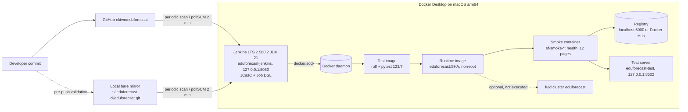

# DevOps: Docker, Jenkins CI/CD, test deployment

This folder documents the CI/CD setup of EduForecast-SIS (Assignment 5).
Operations: [RUNBOOK.md](RUNBOOK.md). Measured results: [EVIDENCE.md](EVIDENCE.md).
Screenshot list: [SCREENSHOTS.md](SCREENSHOTS.md). Console logs: [logs/](logs/).

## Architecture

## Components

| file | purpose |
|---|---|
| `Dockerfile` | multi-stage: `base` (python:3.12.13-slim-bookworm + `requirements-ci.txt` + libgomp1), `test` (+ git, ruff 0.16.10, pytest-cov 7.1.0, full tree), `runtime` (default; non-root uid 10001, only runtime files, OCI labels, HEALTHCHECK on `/_stcore/health`) |
| `.dockerignore` | allowlist: build context is about 1.2 MB, no `.git`, `.venv`, `.env*`, datasets or caches |
| `scripts/devops/page_smoke.py` | renders every page listed in `app/main.py` with Streamlit AppTest; fails on any exception |
| `scripts/devops/smoke_container.sh` | runs the runtime image on a private network, waits for `healthy`, checks health from a second container, non-root, no `.env`, runs `page_smoke.py` |
| `jenkins/` | controller image (Docker CLI + buildx, pinned plugins), `docker-compose.yml`, JCasC (`casc/jenkins.yaml`), optional Docker Hub credential, `.env.jenkins.example` |
| `Jenkinsfile` | Checkout, Build test image, Lint, Unit tests (JUnit + coverage), Build image, Smoke test, Push image (optional), Deploy to test server (main) |
| `scripts/devops/sync_mirror.sh` | updates the local bare mirror Jenkins reads before anything is pushed to GitHub |
| `k8s/`, `scripts/devops/k3d_*.sh`, `k8s_deploy.sh` | optional Kubernetes (k3d) deployment; written but not executed (owner declined installing k3d) |
| `scripts/devops/prepush_audit.sh` | secret and data scan of what would be pushed |
| `Makefile` | shortcuts: `docker-build`, `docker-test`, `jenkins-up`, `smoke`, `mirror-sync`, ... |

## Pipeline

| stage | what it does | fails when |
|---|---|---|
| Checkout | prints branch, commit, short SHA, Docker versions | — |
| Build test image | `docker build --target test` | dependency or build error |
| Lint | `ruff check --select E9,F63,F7,F82 app src tests` (same as `.github/workflows/ci.yml`) | syntax errors / undefined names |
| Unit tests | `docker run` of the test image, `docker cp` of `junit.xml` and `coverage.xml`, JUnit report, artifacts | any failing test (exit code of pytest) |
| Build image | runtime target, tags `<sha>`, `build-<N>`, `latest` (main only); archives `image-info.txt`, `pip-freeze.txt` | build error |
| Smoke test | `scripts/devops/smoke_container.sh` | not healthy in 60 s, root user, `.env` found, page exception |
| Push image | only with `PUSH_IMAGE=true`; `localhost:*` registries without login, others via the `dockerhub-credentials` credential and `docker login --password-stdin` in a temporary `DOCKER_CONFIG` | registry/credential error |
| Deploy to test server | `DEPLOY_TEST=true` and branch `main`: replaces container `eduforecast-test` on `127.0.0.1:8502`, waits for healthy, checks health from a second container | not healthy in 90 s |

`post { always }` removes only this build's `ef-tests-*`, `ef-smoke-*` resources and the build's test-image tag, then cleans the workspace.

Triggers: `pollSCM('H/2 * * * *')` in the Jenkinsfile and a 2-minute periodic branch scan of the multibranch job (Job DSL). No webhooks.

## Design decisions

- **No data, no secrets in images.** The app runs in "no data" / briefing mode; pages without data show empty states (verified by `page_smoke.py`). `.env` never enters the build context.
- **Runtime files were traced, not guessed.** An audit hook recorded every file the pages open: `.streamlit/config.toml`, `data/aitu/financials_2019_2020.csv`, `data/research/raw/yearly_work_counts_I4405257690.json`, `src/advisor/facts/snapshot.json`, `src/finance/rules.yaml`.
- **Writable directories for the non-root user.** `src/research/config.py` and `src/finance/config.py` create directories at import time and the advisor writes `logs/`, so `data/`, `results/`, `logs/`, `docs/` in the image belong to the app user; the code stays root-owned.
- **Jenkins as root with the Docker socket** is root-equivalent on the Docker host. Acceptable only for this local study setup: Jenkins listens on 127.0.0.1 only and has no agent port.
- **Tests run in containers, not in the Jenkins JVM container**, so the Jenkins image needs no Python.
